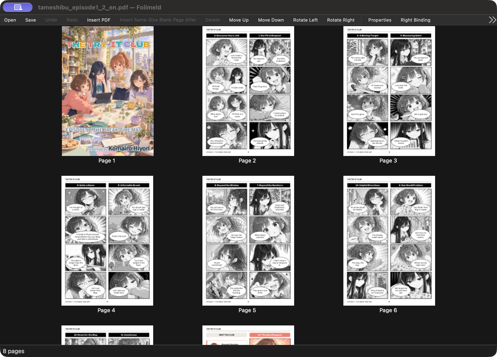
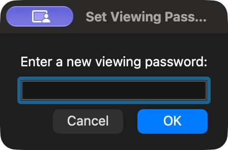

# Folimeld

[English](README.md) | [日本語](README_ja.md)

[Homepage](https://tyamada.github.io/Folimeld/)


Folimeld is a desktop application for visually rearranging, rotating, inserting, and deleting PDF pages. It is available for Windows, macOS, Ubuntu, and Debian, with preview releases for openSUSE, Fedora, AlmaLinux, FreeBSD, NetBSD, and OpenBSD. Files are processed locally without sending them to external services.



### Create a PDF from an image folder

Choose “File → Create PDF from image folder…” to list JPEG, PNG, BMP, TIFF, and WebP files directly in a folder. Sort by name, creation time, or modification time in ascending or descending order; the default is natural name order, ascending. Exclude unwanted images. Images are not decoded until you press Load. Each image becomes one page (each multipage TIFF frame becomes a page) in a new unsaved PDF for editing and saving. Choose image-sized pages or A4. Image orientation is applied and transparency is flattened onto white. Image-sized pages use image DPI, falling back to 300 DPI for missing or invalid values. Subfolders and animated WebP are excluded. Unavailable creation times sort last; equal timestamps use ascending name order. Conversion can be cancelled, and failures preserve the current document.


Choose File → Exit to close the app, with a save prompt for unsaved changes. On Windows, the image folder picker provides sidebar shortcuts to configured personal and work OneDrive folders. The initial folder picker displays all file types while accepting folders only.

## Features

- Multi-step Undo and Redo from the Edit menu or toolbar for page operations, properties, and viewing password changes. History remains available after saving and resets when another PDF is opened. PDF data in Undo and Redo history is kept in memory up to a combined 128 MiB; overflow is stored in local temporary files up to a combined 1 GiB. Older history is removed when both limits are exceeded or spilling fails; a single entry larger than the disk limit is not retained. Temporary history is released when the document is closed. Temporary data used during editing and saving, and thumbnails, are outside these limits, and whole-document processing can temporarily increase memory usage.
- Saving shows a progress dialog and compresses and writes the PDF in a separate process. Editing and cancellation are unavailable during saving. Preparing the document for the worker and switching documents after saving remain synchronous.
- Spilled history, temporary save-process input, and intermediate image-conversion PDFs are encrypted, with keys kept out of files and settings. User-selected output PDFs use the selected password settings.
- Rearrange PDF pages using thumbnail previews
- Select, move, rotate, or delete multiple pages at once
- Insert another PDF or a blank page of the same size
- Edit the PDF version, page layout, and binding direction
- Set or remove a password required to open a PDF
- Available in Japanese, English, German, Spanish, French, Korean, Portuguese, and Chinese
- Available for Windows 11, macOS, Ubuntu, and Debian, with previews for openSUSE, Fedora, AlmaLinux, FreeBSD, NetBSD, and OpenBSD (see the table below for OS versions and CPUs)

Each BSD preview has its own target OS version, CPU, and verification record. See the OS sections below for the tested scope and installation instructions.

## Downloads

**Folimeld 1.0.1.0 for Windows 11 (x64)** is available for free on the Microsoft Store in Japan and the United States. [Microsoft Store (Japan)](https://apps.microsoft.com/detail/9P5X2JFZRJC3?hl=ja-JP&gl=JP) · [Microsoft Store (United States)](https://apps.microsoft.com/detail/9P5X2JFZRJC3?hl=en-US&gl=US)

Folimeld 0.3.4 for Ubuntu/Debian is available on [GitHub Releases](https://github.com/tyamada/Folimeld/releases/tag/linux-v0.3.4). Separate 0.3.5 previews are available for [Ubuntu/Debian/Kali amd64 DEB](https://github.com/tyamada/Folimeld/releases/tag/linux-deb-amd64-v0.3.5), [openSUSE Tumbleweed 20261110 amd64](https://github.com/tyamada/Folimeld/releases/tag/opensuse-tumbleweed20261110-amd64-v0.3.5), [openSUSE Leap 16.1 amd64](https://github.com/tyamada/Folimeld/releases/tag/opensuse-leap161-amd64-v0.3.5), [Fedora 44 amd64](https://github.com/tyamada/Folimeld/releases/tag/fedora44-amd64-v0.3.5), [Fedora 45 amd64](https://github.com/tyamada/Folimeld/releases/tag/fedora45-amd64-v0.3.5) and [AlmaLinux 9 amd64](https://github.com/tyamada/Folimeld/releases/tag/almalinux9-amd64-v0.3.5).

Linux 0.3.3 packages, matching source ZIPs, checksums and build records are available in the [Linux GitHub Release](https://github.com/tyamada/Folimeld/releases/tag/linux-v0.3.3). FreeBSD, NetBSD, and OpenBSD previews are distributed through their dedicated Releases below. See the [Linux migration plan and implementation record](documentation/linux-release-migration.md). Existing repository download URLs remain available for compatibility.

| OS | CPU | Distribution and version | Release |
| --- | --- | --- | --- |
| Windows 11 | x64 | Microsoft Store / 1.0.1.0 | [Matching source](https://github.com/tyamada/Folimeld/releases/tag/windows-store-v1.0.1.0) |
| Windows 11 | x64 | Desktop installer / 0.3.5.0 (preview) | [Release](https://github.com/tyamada/Folimeld/releases/tag/windows-desktop-v0.3.5.0-preview.1) |
| Windows 11 | x64 | Source + uv / 0.3.5 (preview) | [Release](https://github.com/tyamada/Folimeld/releases/tag/windows-uv-v0.3.5-preview.1) |
| Windows 11 | x64 | uv tool install (Wheel) / 0.3.5 (preview) | [Release](https://github.com/tyamada/Folimeld/releases/tag/windows-uv-tool-v0.3.5-preview.1) |
| Windows 11 | arm64 | Desktop installer / 0.3.5.0 (preview) | [Release](https://github.com/tyamada/Folimeld/releases/tag/windows-desktop-arm64-v0.3.5.0-preview.1) |
| Windows 11 | arm64 | Source + uv / 0.3.5 (preview) | [Release](https://github.com/tyamada/Folimeld/releases/tag/windows-uv-arm64-v0.3.5-preview.1) |
| Windows 11 | arm64 | uv tool install (Wheel) / 0.3.5 (preview) | [Release](https://github.com/tyamada/Folimeld/releases/tag/windows-uv-tool-arm64-v0.3.5-preview.1) |
| macOS 15 or later | Apple Silicon (arm64) | Homebrew / 0.3.3 (source) | [Release](https://github.com/tyamada/Folimeld/releases/tag/macos-source-v0.3.3) |
| Ubuntu 24.04 | amd64 / arm64 | DEB / Snap / 0.3.4 | [Release](https://github.com/tyamada/Folimeld/releases/tag/linux-v0.3.4) |
| Debian 13 | amd64 / arm64 | DEB / 0.3.4 | [Release](https://github.com/tyamada/Folimeld/releases/tag/linux-v0.3.4) |
| Ubuntu 24.04.5 / Debian 13.7 (verified with Xorg in ARM64 VMs) | arm64 | DEB / 0.3.5 (preview) | [Release](https://github.com/tyamada/Folimeld/releases/tag/linux-deb-arm64-v0.3.5) |
| Ubuntu 24.04.5 (verified with Xorg in an ARM64 VM) | arm64 | strict Snap / 0.3.5 (preview) | [Release](https://github.com/tyamada/Folimeld/releases/tag/linux-snap-arm64-v0.3.5) |
| Ubuntu 24.04.4 / Debian 13.6 / Kali Rolling 2026.3 (verified on WSL2/WSLg) | amd64 | DEB / 0.3.5 (preview) | [Release](https://github.com/tyamada/Folimeld/releases/tag/linux-deb-amd64-v0.3.5) |
| openSUSE Tumbleweed 20261110 (verified on WSL2/WSLg) | amd64 | RPM / 0.3.5-1 (preview) | [Release](https://github.com/tyamada/Folimeld/releases/tag/opensuse-tumbleweed20261110-amd64-v0.3.5) |
| openSUSE Leap 16.1 (verified with Xorg in an ARM64 VM) | arm64 | RPM / 0.3.5-1 (preview) | [Release](https://github.com/tyamada/Folimeld/releases/tag/opensuse-leap161-arm64-v0.3.5) |
| openSUSE Tumbleweed 20261111 (verified with Xorg in an ARM64 VM) | arm64 | RPM / 0.3.5-1 (preview) | [Release](https://github.com/tyamada/Folimeld/releases/tag/opensuse-tumbleweed-arm64-v0.3.5) |
| Kali 2026.3 / kali-last-snapshot (verified with Xorg in an ARM64 VM) | arm64 | DEB / 0.3.5 (preview) | [Release](https://github.com/tyamada/Folimeld/releases/tag/kali-arm64-v0.3.5) |
| openSUSE Leap 16.1 (verified on WSL2/WSLg) | amd64 | RPM / 0.3.5-1 (preview) | [Release](https://github.com/tyamada/Folimeld/releases/tag/opensuse-leap161-amd64-v0.3.5) |
| Fedora 44 (verified with Xorg in an ARM64 VM) | arm64 | RPM / 0.3.5-1 (preview) | [Release](https://github.com/tyamada/Folimeld/releases/tag/fedora44-arm64-v0.3.5) |
| Fedora 44 (verified on WSL2/WSLg) | amd64 | RPM / 0.3.5-2 (preview) | [Release](https://github.com/tyamada/Folimeld/releases/tag/fedora44-amd64-v0.3.5) |
| Fedora 45 (verified with Xorg in an ARM64 VM) | arm64 | RPM / 0.3.5-1 (preview) | [Release](https://github.com/tyamada/Folimeld/releases/tag/fedora45-arm64-v0.3.5) |
| Fedora 45 (verified on WSL2/WSLg) | amd64 | RPM / 0.3.5-2 (preview) | [Release](https://github.com/tyamada/Folimeld/releases/tag/fedora45-amd64-v0.3.5) |
| AlmaLinux 9.8 (verified with Xorg in an ARM64 VM) | arm64 | RPM / 0.3.5-2 (preview) | [Release](https://github.com/tyamada/Folimeld/releases/tag/almalinux9-arm64-v0.3.5) |
| AlmaLinux 9.8 (verified on WSL2/WSLg) | amd64 | RPM / 0.3.5-5 (preview) | [Release](https://github.com/tyamada/Folimeld/releases/tag/almalinux9-amd64-v0.3.5) |
| FreeBSD 15.1 | amd64 | pkg / 0.3.3_1 (preview) | [Release](https://github.com/tyamada/Folimeld/releases/tag/freebsd-v0.3.3) |
| FreeBSD 15.1 | aarch64 | pkg / 0.3.3_1 (preview) | [Release](https://github.com/tyamada/Folimeld/releases/tag/freebsd-aarch64-v0.3.3_1) |
| NetBSD 11.1 | amd64 | tgz / 0.3.3 (preview) | [Release](https://github.com/tyamada/Folimeld/releases/tag/netbsd-v0.3.3) |
| NetBSD 11.1 | aarch64 | tgz / 0.3.3 (preview) | [Release](https://github.com/tyamada/Folimeld/releases/tag/netbsd-aarch64-v0.3.3) |
| OpenBSD 8.0 | amd64 | Signed tgz / 0.3.3 (preview) | [Release](https://github.com/tyamada/Folimeld/releases/tag/openbsd-v0.3.3) |
| OpenBSD 8.0 | arm64 | Signed tgz / 0.3.3 (preview) | [Release](https://github.com/tyamada/Folimeld/releases/tag/openbsd-aarch64-v0.3.3) |

Versions in the table are specific to each distribution channel. The Windows Store edition is available in Japan and the United States. Linux 0.3.3 downloads for Ubuntu 22.04 or later and older installation instructions remain below. BSD ARM64 packages use the name `aarch64` on FreeBSD and NetBSD, and `arm64` on OpenBSD.

> [!NOTE]
> Windows test binaries and locally built macOS apps and installers are kept locally. Public source archives are available from their respective Releases.

### Windows 11 installation and corresponding source

- **Install from the Microsoft Store** — Open the Japan or United States listing above, then select **Get** or **Install** in the Microsoft Store. Launch Folimeld from the Start menu when installation completes.
- **Get the source** — Use **Code → Download ZIP** or Git to get the Windows code and build scripts from the [public main branch](https://github.com/tyamada/Folimeld/tree/main).
- **Source for Store version 1.0.1.0 x64** — [Source ZIP](https://github.com/tyamada/Folimeld/releases/download/windows-store-v1.0.1.0/Folimeld-1.0.1.0-windows-x64-source.zip) · [SHA-256 checksums](https://github.com/tyamada/Folimeld/releases/download/windows-store-v1.0.1.0/SHA256SUMS.txt) · [Submission association record](https://github.com/tyamada/Folimeld/releases/download/windows-store-v1.0.1.0/source-association.json). Three documentation files were revised for publication. The application source and build files match the submitted build's source snapshot.

The standard Windows 11 distribution channel is Microsoft Store. See the [development guide](DEVELOPMENT.md) for the Store MSIX workflow.

### Windows 11 source + uv preview (x64 / ARM64)

[**Folimeld 0.3.5 Windows x64 uv preview**](https://github.com/tyamada/Folimeld/releases/tag/windows-uv-v0.3.5-preview.1) and [**Folimeld 0.3.5 Windows ARM64 uv preview**](https://github.com/tyamada/Folimeld/releases/tag/windows-uv-arm64-v0.3.5-preview.1) are available as additional distribution channels. Microsoft Store remains the standard Windows distribution channel. This preview is not an MSIX or standalone EXE.

- **x64 edition**: [Source ZIP](https://github.com/tyamada/Folimeld/releases/download/windows-uv-v0.3.5-preview.1/Folimeld-0.3.5-windows-x64-uv-source-1475b48-candidate1.zip) · [Internal manifest](https://github.com/tyamada/Folimeld/releases/download/windows-uv-v0.3.5-preview.1/source-manifest.json) · [Source commit association](https://github.com/tyamada/Folimeld/releases/download/windows-uv-v0.3.5-preview.1/SOURCE-ASSOCIATION.txt) · [SHA-256 checksums](https://github.com/tyamada/Folimeld/releases/download/windows-uv-v0.3.5-preview.1/SHA256SUMS.txt)
- **ARM64 edition**: [Source ZIP](https://github.com/tyamada/Folimeld/releases/download/windows-uv-arm64-v0.3.5-preview.1/Folimeld-0.3.5-windows-arm64-uv-source-454735d-candidate1.zip) · [Internal manifest](https://github.com/tyamada/Folimeld/releases/download/windows-uv-arm64-v0.3.5-preview.1/source-manifest.json) · [Source commit association](https://github.com/tyamada/Folimeld/releases/download/windows-uv-arm64-v0.3.5-preview.1/SOURCE-ASSOCIATION.txt) · [SHA-256 checksums](https://github.com/tyamada/Folimeld/releases/download/windows-uv-arm64-v0.3.5-preview.1/SHA256SUMS.txt)
- Uses dedicated `.venv` and `.uv-runtime` directories in the installation folder, with settings and logs saved separately under `%LOCALAPPDATA%\Folimeld-UV`. See the Release notes and included [uv installation guide](documentation/windows-uv-source.md) for details and licensing information.

#### 1. Prerequisites

- **Target OS**: Windows 11 x64 (x86_64) or Windows 11 ARM64 (such as Surface Pro 11 Copilot+ PCs / Snapdragon X Elite).
- **Required tools**:
  - **PowerShell 7.2 or later (`pwsh`)**: Use PowerShell 7 rather than Windows-bundled Windows PowerShell 5.1 (can be installed via `winget install --id Microsoft.PowerShell -e` if not already installed).
  - **tar.exe**: Windows-provided utility (`C:\Windows\System32\tar.exe`; standard on Windows 11).
- **Internet access**: Required during installer execution to download pinned CPython, uv, and fourteen runtime dependencies.
- **Privileges**: Runs under standard user privileges. Pre-installing Python or uv manually, administrator privileges, PATH modifications, and execution policy changes are not required.
- **Runtime acquired per architecture (automatically fetched and verified by script)**:
  - **x64**: CPython 3.12.16 (python-build-standalone) + uv 0.13.8 x86_64
  - **ARM64**: CPython 3.12.10 (Python Software Foundation official Authenticode-signed NuGet package) + uv 0.13.8 aarch64. Running on official signed Python **safely passes Windows 11 Smart App Control without triggering block notifications**.

#### 2. Files from GitHub

Download the source ZIP matching your PC's architecture (x64 or ARM64) from GitHub Releases (typically saved to `$HOME\Downloads`):

- **x64 edition**: [**Folimeld-0.3.5-windows-x64-uv-source-1475b48-candidate1.zip**](https://github.com/tyamada/Folimeld/releases/download/windows-uv-v0.3.5-preview.1/Folimeld-0.3.5-windows-x64-uv-source-1475b48-candidate1.zip) (SHA-256: `8B651224221505B4CA6F0F48ECC13989C33573DE4501ACE3A9BA960C2EBB86BA`)
- **ARM64 edition**: [**Folimeld-0.3.5-windows-arm64-uv-source-454735d-candidate1.zip**](https://github.com/tyamada/Folimeld/releases/download/windows-uv-arm64-v0.3.5-preview.1/Folimeld-0.3.5-windows-arm64-uv-source-454735d-candidate1.zip) (SHA-256: `F362A5431D89FC633C852149E0ECD219C22BDAAD07A92229CF7193DBF5E56B72`)

#### 3. Extraction and installation (SHA-256 verification and unblocking the script)

Run in non-elevated PowerShell 7.2 or later. Verify the SHA-256 hash of the downloaded ZIP and extract into a new dedicated folder (e.g. `$HOME\Folimeld-uv-0.3.5`).

```powershell
$ErrorActionPreference = 'Stop'

# Select file and expected hash based on architecture
if ([System.Runtime.InteropServices.RuntimeInformation]::ProcessArchitecture -match 'Arm64') {
    $zip = Join-Path $HOME 'Downloads\Folimeld-0.3.5-windows-arm64-uv-source-454735d-candidate1.zip'
    $expected = 'F362A5431D89FC633C852149E0ECD219C22BDAAD07A92229CF7193DBF5E56B72'
} else {
    $zip = Join-Path $HOME 'Downloads\Folimeld-0.3.5-windows-x64-uv-source-1475b48-candidate1.zip'
    $expected = '8B651224221505B4CA6F0F48ECC13989C33573DE4501ACE3A9BA960C2EBB86BA'
}

# 1. SHA-256 verification
if ((Get-FileHash -LiteralPath $zip -Algorithm SHA256).Hash -ne $expected) {
    throw 'ZIP SHA-256 mismatch. Stop without extracting or running it.'
}

# 2. Extract into dedicated folder
$destination = Join-Path $HOME 'Folimeld-uv-0.3.5'
if (Test-Path -LiteralPath $destination) {
    throw 'Destination already exists. Choose a new dedicated folder.'
}
Expand-Archive -LiteralPath $zip -DestinationPath $destination

# 3. Unblock install_uv.ps1 and execute installation
$scripts = @(Get-ChildItem -LiteralPath $destination -Recurse -File -Filter 'install_uv.ps1')
if ($scripts.Count -ne 1) {
    throw 'Expected exactly one install_uv.ps1. Stop without running it.'
}
$installer = $scripts[0].FullName
Unblock-File -LiteralPath $installer
Push-Location -LiteralPath $scripts[0].DirectoryName
try {
    pwsh -NoProfile -File $installer
    if ($LASTEXITCODE -ne 0) { throw 'Installation failed. Retain the error and installation records.' }
}
finally {
    Pop-Location
}
```

A hash mismatch stops before extraction or execution. The verified ZIP is extracted into a new directory, and the script requires exactly one `install_uv.ps1` before unblocking only that file with `Unblock-File`. It does not unblock the ZIP or a directory recursively.

#### 4. Launch and data storage

- **How to launch**: After installation, launch using the generated **Folimeld UV** shortcut beside `install_uv.ps1`. For diagnostic logging, use **Folimeld UV diagnostics**.
- **Settings and log location**: Stored under `%LOCALAPPDATA%\Folimeld-UV`, isolated from Store, Desktop, and uv tool editions.
- **Notes**: Do not run `main.py` directly. Do not move or rename the installation directory after installation, as internal virtual environment paths are fixed.

### Windows 11 uv tool install preview (Pure Python Wheel / x64 and ARM64)

[**Folimeld 0.3.5 Windows x64 uv tool install preview**](https://github.com/tyamada/Folimeld/releases/tag/windows-uv-tool-v0.3.5-preview.1) and [**Folimeld 0.3.5 Windows ARM64 uv tool install preview**](https://github.com/tyamada/Folimeld/releases/tag/windows-uv-tool-arm64-v0.3.5-preview.1) are available as additional distribution channels separate from the Microsoft Store edition, the Desktop edition, and the source + uv preview. They install a Pure Python Wheel (`folimeld-0.3.5-py3-none-any.whl`) distributed via GitHub Releases into an isolated `uv tool` environment. See the [uv tool install specification and guide](documentation/windows-uv-tool.md) for details.

- **x64 edition**: [Pure Python Wheel](https://github.com/tyamada/Folimeld/releases/download/windows-uv-tool-v0.3.5-preview.1/folimeld-0.3.5-py3-none-any.whl) · [Dependency lock](https://github.com/tyamada/Folimeld/releases/download/windows-uv-tool-v0.3.5-preview.1/requirements-windows-uv.lock) · [Runtime profile](https://github.com/tyamada/Folimeld/releases/download/windows-uv-tool-v0.3.5-preview.1/windows-uv-runtime.json) · [Matching source ZIP](https://github.com/tyamada/Folimeld/releases/download/windows-uv-tool-v0.3.5-preview.1/Folimeld-0.3.5-windows-x64-uv-tool-source.zip) · [Internal manifest](https://github.com/tyamada/Folimeld/releases/download/windows-uv-tool-v0.3.5-preview.1/source-manifest.json) · [Source commit association](https://github.com/tyamada/Folimeld/releases/download/windows-uv-tool-v0.3.5-preview.1/SOURCE-ASSOCIATION.txt) · [Third-party notices](https://github.com/tyamada/Folimeld/releases/download/windows-uv-tool-v0.3.5-preview.1/THIRD-PARTY-NOTICES.txt) · [Dependency sources ledger](https://github.com/tyamada/Folimeld/releases/download/windows-uv-tool-v0.3.5-preview.1/DEPENDENCY-SOURCES.json) · [SHA-256 checksums](https://github.com/tyamada/Folimeld/releases/download/windows-uv-tool-v0.3.5-preview.1/SHA256SUMS.txt)
- **ARM64 edition**: [Pure Python Wheel](https://github.com/tyamada/Folimeld/releases/download/windows-uv-tool-arm64-v0.3.5-preview.1/folimeld-0.3.5-py3-none-any.whl) · [Dependency lock](https://github.com/tyamada/Folimeld/releases/download/windows-uv-tool-arm64-v0.3.5-preview.1/requirements-windows-arm64-uv.lock) · [Runtime profile](https://github.com/tyamada/Folimeld/releases/download/windows-uv-tool-arm64-v0.3.5-preview.1/windows-arm64-uv-runtime.json) · [Matching source ZIP](https://github.com/tyamada/Folimeld/releases/download/windows-uv-tool-arm64-v0.3.5-preview.1/Folimeld-0.3.5-windows-arm64-uv-tool-source.zip) · [Internal manifest](https://github.com/tyamada/Folimeld/releases/download/windows-uv-tool-arm64-v0.3.5-preview.1/source-manifest.json) · [Source commit association](https://github.com/tyamada/Folimeld/releases/download/windows-uv-tool-arm64-v0.3.5-preview.1/SOURCE-ASSOCIATION.txt) · [Third-party notices](https://github.com/tyamada/Folimeld/releases/download/windows-uv-tool-arm64-v0.3.5-preview.1/THIRD-PARTY-NOTICES.txt) · [Dependency sources ledger](https://github.com/tyamada/Folimeld/releases/download/windows-uv-tool-arm64-v0.3.5-preview.1/DEPENDENCY-SOURCES.json) · [SHA-256 checksums](https://github.com/tyamada/Folimeld/releases/download/windows-uv-tool-arm64-v0.3.5-preview.1/SHA256SUMS.txt)
- Requires CPython 3.12.x (minor version match) and exact versions of all fourteen runtime dependencies (hash-verified via lock file).
- Stores settings and logs under `%LOCALAPPDATA%/Folimeld-UV-Tool` without modifying Store, Desktop (`Folimeld-Desktop`), or source + uv (`Folimeld-UV`) profiles or Explorer file associations. Uses the `Local\Folimeld-UV-Tool` mutex for single-instance protection.

#### 1. Prerequisites

Requires Windows 11 (x64 or ARM64) and uv. Run `uv --version` in a non-administrator PowerShell session. If uv is not installed, install it below and reopen PowerShell.

```powershell
winget install --id=Astral.uv -e
uv --version
```

- **You do not need to install Python 3.12 manually beforehand.** With uv's default settings, `--python 3.12` downloads CPython 3.12.x if no suitable Python is available.
- **Smart App Control compatibility**: Executes under the Authenticode-signed Python runtime managed by uv tool, safely passing Windows 11 Smart App Control on ARM64 devices without triggering block notifications.

#### 2. Files to download from GitHub

Save these **two files in the same folder**, such as Downloads:

1. **folimeld-0.3.5-py3-none-any.whl** — the application Pure Python Wheel.
   - x64 Release: [folimeld-0.3.5-py3-none-any.whl](https://github.com/tyamada/Folimeld/releases/download/windows-uv-tool-v0.3.5-preview.1/folimeld-0.3.5-py3-none-any.whl) (SHA-256: `759B2FE0052F1741427194E40104DB0AF65184041AD5BAD8BB5D2003874DBDAF`)
   - ARM64 Release: [folimeld-0.3.5-py3-none-any.whl](https://github.com/tyamada/Folimeld/releases/download/windows-uv-tool-arm64-v0.3.5-preview.1/folimeld-0.3.5-py3-none-any.whl) (SHA-256: `FF06269C5BFC4A53B7BF5B673B48B3CC267744F757F771E29619785CD1150B4E`)
2. **Dependency lockfile** — pinned versions and distribution-wheel SHA-256 hashes for 14 dependencies for your architecture.
   - For x64: [**requirements-windows-uv.lock**](https://github.com/tyamada/Folimeld/releases/download/windows-uv-tool-v0.3.5-preview.1/requirements-windows-uv.lock) (SHA-256: `7E994B4C231536FB5C53D79959761BC426BD9FF9585B578165F1FD67EC19077F`)
   - For ARM64: [**requirements-windows-arm64-uv.lock**](https://github.com/tyamada/Folimeld/releases/download/windows-uv-tool-arm64-v0.3.5-preview.1/requirements-windows-arm64-uv.lock) (SHA-256: `B30019EC8BB3DDD9C15CEBB093432CD309566A6792B3EBCCDE821964B5054B67`)

#### 3. Working directory and installed locations

Run commands **in the folder containing both downloads**, normally `C:\Users\<username>\Downloads`. Adjust the location below if Downloads has been relocated or you saved the files elsewhere.

Unlike the source + uv edition's `install_uv.ps1`, this does not create a `.venv` in the current folder.

- **Tool environment**: the `folimeld` subfolder of `uv tool dir`; a default example is `%APPDATA%\uv\data\tools\folimeld\`.
- **Launch commands**: `folimeld.exe` (GUI) and `folimeld-console.exe` (diagnostics) in `uv tool dir --bin`; a default example is `%USERPROFILE%\.local\bin\` (or direct execution via `folimeld`).
- **Settings and logs**: `%LOCALAPPDATA%\Folimeld-UV-Tool\`, isolated from the Store, Desktop, and source + uv editions.

Environment variables can override these locations. Check the actual directories:

```powershell
uv tool dir
uv tool dir --bin
```

**After successful installation, moving or deleting the downloaded Wheel and lock does not prevent the installed app from running.** Keep both files and their hashes for reinstallation. Do not delete the uv-managed environment or the Python it uses.

#### 4. SHA-256 verification and installation

```powershell
$ErrorActionPreference = 'Stop'

# Adjust this if you saved the files elsewhere
Set-Location -LiteralPath (Join-Path $HOME 'Downloads')

# Verify SHA-256 and install based on architecture
if ([System.Runtime.InteropServices.RuntimeInformation]::ProcessArchitecture -match 'Arm64') {
    if ((Get-FileHash -LiteralPath .\folimeld-0.3.5-py3-none-any.whl -Algorithm SHA256).Hash -ne 'FF06269C5BFC4A53B7BF5B673B48B3CC267744F757F771E29619785CD1150B4E') {
        throw 'Wheel SHA-256 mismatch.'
    }
    if ((Get-FileHash -LiteralPath .\requirements-windows-arm64-uv.lock -Algorithm SHA256).Hash -ne 'B30019EC8BB3DDD9C15CEBB093432CD309566A6792B3EBCCDE821964B5054B67') {
        throw 'Lock SHA-256 mismatch.'
    }
    uv tool install --python 3.12 --with-requirements .\requirements-windows-arm64-uv.lock --no-build .\folimeld-0.3.5-py3-none-any.whl
} else {
    if ((Get-FileHash -LiteralPath .\folimeld-0.3.5-py3-none-any.whl -Algorithm SHA256).Hash -ne '759B2FE0052F1741427194E40104DB0AF65184041AD5BAD8BB5D2003874DBDAF') {
        throw 'Wheel SHA-256 mismatch.'
    }
    if ((Get-FileHash -LiteralPath .\requirements-windows-uv.lock -Algorithm SHA256).Hash -ne '7E994B4C231536FB5C53D79959761BC426BD9FF9585B578165F1FD67EC19077F') {
        throw 'Lock SHA-256 mismatch.'
    }
    uv tool install --python 3.12 --with-requirements .\requirements-windows-uv.lock --no-build .\folimeld-0.3.5-py3-none-any.whl
}

if ($LASTEXITCODE -ne 0) { throw 'uv tool install failed.' }
```

#### 5. Launch

Once the executable directory is on PATH, launch from **any folder**:

```powershell
# Standard GUI launch without a console
folimeld

# Diagnostic launch with console output
folimeld-console
```

> [!TIP]
> If you see `warning: ... is not on your PATH`, run `uv tool update-shell` once and reopen PowerShell. This updates your user shell/PATH settings; no machine-wide execution-policy change is needed.

To uninstall, run `uv tool uninstall folimeld` (settings and logs are preserved).

### Windows 11 Desktop installer preview (PyInstaller onedir + Inno Setup / x64 and ARM64)

[**Folimeld 0.3.5.0 Windows x64 Desktop preview**](https://github.com/tyamada/Folimeld/releases/tag/windows-desktop-v0.3.5.0-preview.1) and [**Folimeld 0.3.5.0 Windows ARM64 Desktop preview**](https://github.com/tyamada/Folimeld/releases/tag/windows-desktop-arm64-v0.3.5.0-preview.1) are available as per-user installers that require no pre-installed Python, uv, or PowerShell. The Microsoft Store edition remains the standard Windows distribution channel, and this edition keeps its install directory, settings, logs, and mutex strictly separate from the Store, source + uv, and `uv tool install` editions. See the [Desktop build specification and verification record](documentation/windows-desktop-build.md) and [per-version source guide](documentation/windows-desktop-sources.md) for details.

- **x64 edition**: [Setup EXE](https://github.com/tyamada/Folimeld/releases/download/windows-desktop-v0.3.5.0-preview.1/Folimeld-Desktop-0.3.5.0-x64-setup.exe) · [Matching source ZIP](https://github.com/tyamada/Folimeld/releases/download/windows-desktop-v0.3.5.0-preview.1/Folimeld-0.3.5.0-windows-x64-desktop-source.zip) · [Payload ledger](https://github.com/tyamada/Folimeld/releases/download/windows-desktop-v0.3.5.0-preview.1/payload-review.json) · [Internal source manifest](https://github.com/tyamada/Folimeld/releases/download/windows-desktop-v0.3.5.0-preview.1/source-manifest.json) · [Source commit association](https://github.com/tyamada/Folimeld/releases/download/windows-desktop-v0.3.5.0-preview.1/SOURCE-ASSOCIATION.txt) · [Third-party notices](https://github.com/tyamada/Folimeld/releases/download/windows-desktop-v0.3.5.0-preview.1/THIRD-PARTY-NOTICES.txt) · [Dependency sources ledger](https://github.com/tyamada/Folimeld/releases/download/windows-desktop-v0.3.5.0-preview.1/DEPENDENCY-SOURCES.json) · [CRT user notice](https://github.com/tyamada/Folimeld/releases/download/windows-desktop-v0.3.5.0-preview.1/CRT-USER-NOTICE.txt) · [SHA-256 checksums](https://github.com/tyamada/Folimeld/releases/download/windows-desktop-v0.3.5.0-preview.1/SHA256SUMS.txt)
- **ARM64 edition**: [Setup EXE](https://github.com/tyamada/Folimeld/releases/download/windows-desktop-arm64-v0.3.5.0-preview.1/Folimeld-Desktop-0.3.5.0-arm64-setup.exe) · [Matching source ZIP](https://github.com/tyamada/Folimeld/releases/download/windows-desktop-arm64-v0.3.5.0-preview.1/Folimeld-0.3.5.0-windows-arm64-desktop-source.zip) · [Payload ledger](https://github.com/tyamada/Folimeld/releases/download/windows-desktop-arm64-v0.3.5.0-preview.1/payload-review.json) · [Internal source manifest](https://github.com/tyamada/Folimeld/releases/download/windows-desktop-arm64-v0.3.5.0-preview.1/source-manifest.json) · [Source commit association](https://github.com/tyamada/Folimeld/releases/download/windows-desktop-arm64-v0.3.5.0-preview.1/SOURCE-ASSOCIATION.txt) · [Third-party notices](https://github.com/tyamada/Folimeld/releases/download/windows-desktop-arm64-v0.3.5.0-preview.1/THIRD-PARTY-NOTICES.txt) · [Dependency sources ledger](https://github.com/tyamada/Folimeld/releases/download/windows-desktop-arm64-v0.3.5.0-preview.1/DEPENDENCY-SOURCES.json) · [CRT user notice](https://github.com/tyamada/Folimeld/releases/download/windows-desktop-arm64-v0.3.5.0-preview.1/CRT-USER-NOTICE.txt) · [SHA-256 checksums](https://github.com/tyamada/Folimeld/releases/download/windows-desktop-arm64-v0.3.5.0-preview.1/SHA256SUMS.txt)

#### 1. Prerequisites

- **Target OS**: Windows 11 x64 (x86_64) or Windows 11 ARM64 (Surface Pro 11 Copilot+ PCs / Snapdragon X Elite). Runs as native binaries for each architecture.
- **Required tools / runtime**:
  - Pre-installing Python, uv, or PowerShell is **not required**. The required Python 3.12 runtime, PyQt6, runtime dependencies, and Microsoft VC++ Runtime (CRT) are bundled inside (onedir format).
- **Privileges**: Runs under standard user privileges (administrator elevation / UAC is not required).
- **Internet access**: Not required during installation; the installer package is fully self-contained for offline installation.

#### 2. Files from GitHub

Download the installer matching your PC's architecture from GitHub Releases (typically saved to `$HOME\Downloads`):

- **x64 edition**: [**Folimeld-Desktop-0.3.5.0-x64-setup.exe**](https://github.com/tyamada/Folimeld/releases/download/windows-desktop-v0.3.5.0-preview.1/Folimeld-Desktop-0.3.5.0-x64-setup.exe) (~47.9 MB, SHA-256: `ADBE1B0E983F1DFA9BD62D5782EE173AE47E5F625F3BABD24B55CC0B5E6386C3`)
- **ARM64 edition**: [**Folimeld-Desktop-0.3.5.0-arm64-setup.exe**](https://github.com/tyamada/Folimeld/releases/download/windows-desktop-arm64-v0.3.5.0-preview.1/Folimeld-Desktop-0.3.5.0-arm64-setup.exe) (~37.7 MB, SHA-256: `D19DB07CDD56D5A72C12879CA2BFB5E126AD7532E3F431E2C07413279727633C`)

#### 3. SHA-256 verification and installation steps

1. **SHA-256 verification**:
   Open PowerShell in your download folder and verify the checksum. If it does not match, discard the file without running it.
   ```powershell
   $ErrorActionPreference = 'Stop'
   Set-Location -LiteralPath (Join-Path $HOME 'Downloads')

   if ([System.Runtime.InteropServices.RuntimeInformation]::ProcessArchitecture -match 'Arm64') {
       $file = '.\Folimeld-Desktop-0.3.5.0-arm64-setup.exe'
       $expected = 'D19DB07CDD56D5A72C12879CA2BFB5E126AD7532E3F431E2C07413279727633C'
   } else {
       $file = '.\Folimeld-Desktop-0.3.5.0-x64-setup.exe'
       $expected = 'ADBE1B0E983F1DFA9BD62D5782EE173AE47E5F625F3BABD24B55CC0B5E6386C3'
   }

   if ((Get-FileHash -LiteralPath $file -Algorithm SHA256).Hash -ne $expected) {
       throw 'Installer SHA-256 mismatch. Stop without running it.'
   }
   ```
2. **Launch the installer**:
   Run the setup EXE. If Windows SmartScreen displays a warning ("Windows protected your PC") for this unsigned preview, click "**More info**" and select "**Run anyway**".
   > [!NOTE]
   > **Windows 11 Smart App Control Guidance**
   > On Windows 11 systems (particularly ARM64 Copilot+ PCs) where Smart App Control is enforcing, unsigned binaries downloaded from the web may trigger block notifications ("An app was blocked").
   > - If blocked, open the installer file's Properties dialog and check "Unblock", or click "Allow" to proceed.
   > - To avoid block notifications entirely, use the Authenticode-signed Python distributions: **[source + uv preview](#windows-11-source--uv-preview-x64--arm64)** or **[uv tool install preview](#windows-11-uv-tool-install-preview-pure-python-wheel--x64-and-arm64)**.
3. **Setup wizard steps**:
   - **License agreement**: The displayed English license terms apply solely to the bundled Microsoft Visual C++ Runtime (x64: `14.44.35211.0` / ARM64: `14.52.37029.0`). Select "I accept the agreement" and click "Next" (Folimeld itself is licensed under AGPL-3.0, and open-source notices are stored under `_internal\licenses\`).
   - **Destination**: Installs per-user without elevation to `%LOCALAPPDATA%\Programs\Folimeld-Desktop\versions\0.3.5.0`. Click "Next" to accept the default.
   - **Additional tasks**: Optionally select "Create a desktop shortcut" and click "Install" to complete setup (the app does not automatically launch upon exit).

#### 4. Launch and data storage

- **How to launch**:
  - In the Start Menu, open the "**Folimeld Desktop**" group and click "**Folimeld Desktop**" (or use the desktop shortcut if created).
  - Executable path: `%LOCALAPPDATA%\Programs\Folimeld-Desktop\versions\0.3.5.0\FolimeldDesktop.exe`
- **Settings and log location**:
  - Settings: `%LOCALAPPDATA%\Folimeld-Desktop\settings\settings.ini`
  - Logs: `%LOCALAPPDATA%\Folimeld-Desktop\logs\<version>\<launch-id>\folimeld.log`
  - Completely isolated from Store, source + uv, and uv tool editions.
- **Single-instance protection and uninstallation**:
  - Holds the `Local\Folimeld-Desktop` mutex while running to safely prevent duplicate launches and running updates/uninstalls.
  - To uninstall, use Windows "Settings" -> "Installed apps" -> "Folimeld Desktop" -> "Uninstall". App binaries and shortcuts are removed while user settings and logs are preserved.

### Install on macOS with Homebrew

The Folimeld 0.3.3 Homebrew release supports **Apple Silicon (arm64) Macs running macOS 15 Sequoia or later**. With Homebrew installed, run these commands in Terminal.

```sh
brew install --build-from-source tyamada/tap/folimeld
folimeld
```

Homebrew sets up Python 3.14 and an isolated environment for the app's dependencies. The `folimeld` command opens the PDF editor.

The [Folimeld 0.3.3 GitHub Release for macOS](https://github.com/tyamada/Folimeld/releases/tag/macos-source-v0.3.3) includes the [source archive](https://github.com/tyamada/Folimeld/releases/download/macos-source-v0.3.3/folimeld-0.3.3-source.tar.gz) and [SHA-256 checksums](https://github.com/tyamada/Folimeld/releases/download/macos-source-v0.3.3/SHA256SUMS.txt).

### Direct downloads for Ubuntu / Debian

#### Folimeld 0.3.4

| Package | Supported distributions | Downloads |
| --- | --- | --- |
| DEB | Ubuntu 24.04 / Debian 13 | [amd64](https://github.com/tyamada/Folimeld/releases/download/linux-v0.3.4/folimeld_0.3.4_amd64.deb) / [ARM64](https://github.com/tyamada/Folimeld/releases/download/linux-v0.3.4/folimeld_0.3.4_arm64.deb) |
| Snap | Ubuntu 24.04 (requires snapd) | [amd64](https://github.com/tyamada/Folimeld/releases/download/linux-v0.3.4/folimeld_0.3.4_amd64.snap) / [ARM64](https://github.com/tyamada/Folimeld/releases/download/linux-v0.3.4/folimeld_0.3.4_arm64.snap) |

The [Linux 0.3.4 GitHub Release](https://github.com/tyamada/Folimeld/releases/tag/linux-v0.3.4) includes matching source archives and build records. Verify downloads against [SHA256SUMS.txt](https://github.com/tyamada/Folimeld/releases/download/linux-v0.3.4/SHA256SUMS.txt).

#### Folimeld 0.3.3

Version **0.3.3 / x86_64 (amd64)**:

- [Download the x86_64 deb package](https://github.com/tyamada/Folimeld/releases/download/linux-v0.3.3/folimeld_0.3.3_amd64.deb) (Ubuntu 22.04 or later / Debian 13)
- [Download the x86_64 Snap package](https://github.com/tyamada/Folimeld/releases/download/linux-v0.3.3/folimeld_0.3.3_amd64.snap) (requires snapd)
- [SHA-256 checksums](https://github.com/tyamada/Folimeld/releases/download/linux-v0.3.3/folimeld_0.3.3_SHA256SUMS.txt)
- [Build source snapshots and artifact records](https://github.com/tyamada/Folimeld/releases/tag/linux-v0.3.3)

Run the installation command for your chosen package from the download folder.

```bash
# deb package
sudo apt install ./folimeld_0.3.3_amd64.deb

# Snap package
sudo snap install --dangerous ./folimeld_0.3.3_amd64.snap
```

Version **0.3.3 / arm64 (AArch64)**:

- [Download the arm64 deb package](https://github.com/tyamada/Folimeld/releases/download/linux-v0.3.3/folimeld_0.3.3_arm64.deb) (Ubuntu 22.04 or later / Debian 13)
- [Download the arm64 Snap package](https://github.com/tyamada/Folimeld/releases/download/linux-v0.3.3/folimeld_0.3.3_arm64.snap) (requires snapd)
- [SHA-256 checksums](https://github.com/tyamada/Folimeld/releases/download/linux-v0.3.3/folimeld_0.3.3_SHA256SUMS.txt)
- [Build source snapshots and artifact records](https://github.com/tyamada/Folimeld/releases/tag/linux-v0.3.3)

```bash
# arm64 deb package
sudo apt install ./folimeld_0.3.3_arm64.deb

# arm64 Snap package
sudo snap install --dangerous ./folimeld_0.3.3_arm64.snap
```

Debian 13 uses the same deb package as Ubuntu. If a minimal installation displays `Fontconfig error: Cannot load default config file`, run `sudo apt install fontconfig-config`. PDF display, page movement, rotation, saving, and reopening have been verified on Debian 13.6 amd64 (WSL2 / WSLg, X11). See the [Debian verification record](documentation/debian-wsl-verification_ja.md) (in Japanese) for details. Installation of the deb package and startup with a PDF have also been verified on arm64 (WSL2).

### Ubuntu/Debian ARM64 DEB 0.3.5 preview

[**0.3.5 ARM64 DEB**](https://github.com/tyamada/Folimeld/releases/tag/linux-deb-arm64-v0.3.5) is available. Fresh regular-user Xorg checks on Ubuntu 24.04.5 / Debian 13.7 ARM64 covered rotation, undo/redo, movement, blank insertion/deletion, Save As, Japanese-path reopening, image conversion/save, clean exit, removal/reinstallation and document/settings preservation. Saved PDF internals, 409 passing ARM64 tests (9 skipped), minimal-Ubuntu startup and byte-identical DEBs from separate build roots on the same VM were verified. Matching materials for 961 source inputs and 210 AArch64 files, plus post-publication redownload verification of all 16 assets, are provided. Japanese IME, Wayland, physical ARM hardware and encryption/forms GUI were not retested. Existing downloads and latest remain unchanged. [Verification and limitations (Japanese)](documentation/linux-deb-arm64-035-validation_ja.md).

```bash
sudo apt install ./folimeld_0.3.5_arm64.deb
```

### Ubuntu / Debian ARM64 DEB fix preview

[**0.3.4+fix1 ARM64 DEB**](https://github.com/tyamada/Folimeld/releases/tag/linux-deb-arm64-v0.3.4-fix1) is a preview that fixes an exit crash after image conversion. Image conversion, saving, reopening after restart, discard-and-exit, and removal/reinstallation were checked in a regular-user Xorg session on Ubuntu 24.04.5 ARM64. Normal PDF acceptance on Debian 13.7 ARM64 comes from the same DEB's November 11, 2026 records and was not rerun today. The Release provides the DEB, exact application source, dependency sources/notices, and verification scope. Existing 0.3.4/Snap and amd64 downloads remain available.

### Ubuntu ARM64 strict Snap 0.3.5 preview

[**0.3.5 ARM64 strict Snap**](https://github.com/tyamada/Folimeld/releases/tag/linux-snap-arm64-v0.3.5) is available. Fresh regular-user Xorg checks on Ubuntu24.04.5 ARM64 cover major PDF editing/save, Japanese-path reopen, image conversion/save, clean exits, old-version update, same-candidate reinstallation and document/settings preservation. Runtime processes before/after reinstall confirm AppArmor enforce and Seccomp2; same-profile probes allow ordinary Documents reads and deny synthetic hidden-home/unconnected-media reads. Snap bytes match across separate build roots on one VM. Matching materials for 968 source inputs and 210 internal/11 outer AArch64 native files, plus post-publication redownload checks of all 16 assets, are provided. This GitHub asset has no Snap Store assertion and uses external content/base snaps delivered by snapd. Full removal/reinstallation, IME, Wayland and physical ARM hardware were not newly tested. [Verification and limitations (Japanese)](documentation/linux-snap-arm64-035-validation_ja.md).

```bash
sudo snap install --dangerous ./folimeld_0.3.5_arm64.snap
```

### Ubuntu ARM64 strict Snap fix preview

[**0.3.4+fix1 ARM64 Snap**](https://github.com/tyamada/Folimeld/releases/tag/linux-snap-arm64-v0.3.4-fix1) is a strict Snap preview of the same exit-crash fix. A regular-user Xorg session on Ubuntu 24.04.5 ARM64/HVF verified image conversion/save/exit 0, same-candidate reinstallation x5→x6, and document/settings preservation. One run was interrupted with exit 1 when automatic OS updates restarted Xorg; after updates finished, reopening/conversion/discard/exit returned 0. Runtime checks confirmed AppArmor enforce and Seccomp 2. This is a locally installed GitHub asset without a Snap Store assertion. See the Release for limitations, exact matching source and notices.

### Ubuntu / Debian / Kali amd64 DEB preview

**Folimeld 0.3.5**, published on November 13, 2026 (Japan time), is an amd64 DEB preview built on Ubuntu 24.04 and verified in dedicated Ubuntu 24.04.4, Debian 13.6, and Kali Rolling 2026.3 WSL2/WSLg environments. Existing 0.3.4 DEB/Snap and ARM64 downloads remain available. glibc 2.39 or newer is required, along with the official universe repository on Ubuntu.

- [amd64 DEB](https://github.com/tyamada/Folimeld/releases/download/linux-deb-amd64-v0.3.5/folimeld_0.3.5_amd64.deb)
- [SHA256SUMS.txt](https://github.com/tyamada/Folimeld/releases/download/linux-deb-amd64-v0.3.5/SHA256SUMS.txt)
- [Matching source, third-party notices, two dependency-source supplements, and verification records](https://github.com/tyamada/Folimeld/releases/tag/linux-deb-amd64-v0.3.5)

```sh
sha256sum --ignore-missing -c SHA256SUMS.txt
sudo apt install --no-install-recommends ./folimeld_0.3.5_amd64.deb
folimeld
```

All three environments passed updating from their existing versions, removal/reinstallation, regular-user startup, preservation of existing test PDFs/settings, Japanese PDF display, immediate thumbnail rotation, and undo. Ubuntu additionally passed redo, page movement, blank-page insertion/deletion, Japanese/space filename saving and reopening, and offscreen startup in a minimal chroot without development dependencies, Python, or recommended CJK fonts. Conventional desktops, ARM64, other OS versions, and future rolling updates remain unverified. Post-publication checks on Ubuntu 24.04.4 additionally verified Mozc Japanese conversion, GIO association, encrypted-PDF editing/saving and reauthentication, and image import/saving. These additional features were not retested on Debian/Kali. See the [additional verification record](documentation/linux-deb-amd64-extended-verification_ja.md). The package is unsigned. See the [bilingual notes](documentation/linux-deb-amd64-publication-body.md) and [Release](https://github.com/tyamada/Folimeld/releases/tag/linux-deb-amd64-v0.3.5).

### openSUSE Tumbleweed 20261110 amd64 preview

**Folimeld 0.3.5 (RPM revision1)**, published on November 13, 2026 (Japan time), is a preview verified in dedicated WSL2/WSLg Build/Test environments with VERSION_ID=20261110.

- [amd64 RPM](https://github.com/tyamada/Folimeld/releases/download/opensuse-tumbleweed20261110-amd64-v0.3.5/folimeld-0.3.5-1.tw20261110.x86_64.rpm)
- [SHA256SUMS.txt](https://github.com/tyamada/Folimeld/releases/download/opensuse-tumbleweed20261110-amd64-v0.3.5/SHA256SUMS.txt)
- [Matching source, third-party notices, dependency sources, and verification records](https://github.com/tyamada/Folimeld/releases/tag/opensuse-tumbleweed20261110-amd64-v0.3.5)

Download the RPM and SHA256SUMS.txt into the same directory, verify them, and install. The RPM is unsigned. Only the specified local RPM is permitted; standard repository signature checks remain enabled.

```sh
sha256sum --ignore-missing -c SHA256SUMS.txt
sudo zypper install --allow-unsigned-rpm --no-recommends ./folimeld-0.3.5-1.tw20261110.x86_64.rpm
folimeld
```

Verification covered PDF editing, Japanese filename saving/GIO reopening, encrypted PDFs, image PDFs, Mozc input, updates, removal/reinstallation, and preservation of existing test PDFs/settings. A fresh minimal installroot passed offscreen startup as a regular user, but this chroot uses regular rolling repositories and does not verify independent WSL boot pinned to 20261110 or GUI/IME in the minimal environment. Conventional desktops, file-manager interaction, other snapshots, ARM64, and migration from public Ubuntu/Debian 0.3.4 are outside the verified scope. See the [Release](https://github.com/tyamada/Folimeld/releases/tag/opensuse-tumbleweed20261110-amd64-v0.3.5) and [KNOWN-LIMITATIONS.txt](https://github.com/tyamada/Folimeld/releases/download/opensuse-tumbleweed20261110-amd64-v0.3.5/KNOWN-LIMITATIONS.txt) for the IBus switch-command exit status, observed conversion results, and provenance limits.

### openSUSE Leap 16.1 ARM64 preview

[**Leap 16.1 ARM64 RPM 0.3.5-1**](https://github.com/tyamada/Folimeld/releases/tag/opensuse-leap161-arm64-v0.3.5) is available. Fresh regular-user Xorg/IceWM checks with SELinux Enforcing cover installation, PDF editing/save, Japanese-path reopen, image conversion, clean exit, full removal/same-candidate reinstall and Documents/settings preservation. ARM64 passed 410 tests; 999 source inputs, 202 AArch64 native members and public redownloads of all 16 attachments were verified. Executable bytes match across two clean output roots on one VM. Two bundled Brotli libraries are source-built from unmodified Google Brotli 1.1.1, while OS libraries remain unchanged. Unsigned GitHub RPM, glibc>=2.40. Physical ARM/Wayland/IME/cross-version updates remain untested. [Validation and limitations](documentation/opensuse-leap161-arm64-035-validation.md).

[**Tumbleweed 20261111 ARM64 RPM 0.3.5-1**](https://github.com/tyamada/Folimeld/releases/tag/opensuse-tumbleweed-arm64-v0.3.5) is available. Fresh ARM64 checks cover installation, PDF editing/image conversion/save, full removal/reinstall and document/settings preservation. SELinux Enforcing; all3GUI exits0;410tests pass. Verify1001source inputs,201AArch64 native members,32exact signed SRPMs and all16public redownloads. ELF bytes match across two output roots. Unsigned GitHub RPM,glibc>=2.44. Other snapshots,physical ARM,Wayland,IME and cross-version updates remain untested. The minimal desktop needs CJK fonts to display Japanese filenames. [Validation and limitations](documentation/opensuse-tumbleweed-arm64-035-validation.md).

[**Kali 2026.3 ARM64 DEB 0.3.5**](https://github.com/tyamada/Folimeld/releases/tag/kali-arm64-v0.3.5) is available. Normal-user Xorg/IceWM checks cover PDF editing/image conversion/save,purge/reinstall and document/settings preservation. All3GUI exits0;410tests/69subtests pass,9skip. Verify1011source inputs,173AArch64 members,30corresponding source packages and all16public redownloads. CFFI is built from official source with dynamic Kali libffi;ELF and DEB match across two output roots. Unsigned GitHub DEB,glibc>=2.43. Other Kali versions/current rolling,physical ARM,full desktops,Wayland,IME and cross-version updates untested. No app-specific confinement. [Validation and limitations](documentation/kali-arm64-035-validation.md).

```bash
sudo zypper install --allow-unsigned-rpm ./folimeld-0.3.5-1.lp161.aarch64.rpm
```

### openSUSE Leap 16.1 amd64 preview

**Folimeld 0.3.5 (RPM revision1)**, published on November 13, 2026 (Japan time), is a preview verified in dedicated openSUSE Leap 16.1 WSL2/WSLg environments.

- [amd64 RPM](https://github.com/tyamada/Folimeld/releases/download/opensuse-leap161-amd64-v0.3.5/folimeld-0.3.5-1.lp161.x86_64.rpm)
- [SHA256SUMS.txt](https://github.com/tyamada/Folimeld/releases/download/opensuse-leap161-amd64-v0.3.5/SHA256SUMS.txt)
- [Matching source, third-party notices, dependency sources, and verification records](https://github.com/tyamada/Folimeld/releases/tag/opensuse-leap161-amd64-v0.3.5)

Download the RPM and SHA256SUMS.txt into the same directory, verify them, and install. The RPM is unsigned. Only the specified local RPM is permitted; standard repository signature checks remain enabled.

```sh
sha256sum --ignore-missing -c SHA256SUMS.txt
sudo zypper install --allow-unsigned-rpm --no-recommends ./folimeld-0.3.5-1.lp161.x86_64.rpm
folimeld
```

Verification covered PDF editing, Japanese filename saving and GIO reopening, encrypted PDFs, image PDFs, Japanese input, updates, removal/reinstallation, preservation of existing test PDFs/settings, and offscreen startup in a fresh minimal installroot. Conventional desktops, conventional file-manager interaction, ARM64, Tumbleweed, and migration from public Ubuntu/Debian 0.3.4 are outside this verified scope. The minimal-dependency test uses chroot and does not verify independent WSL boot or GUI/IME in the minimal environment. See the [Release](https://github.com/tyamada/Folimeld/releases/tag/opensuse-leap161-amd64-v0.3.5) and [KNOWN-LIMITATIONS.txt](https://github.com/tyamada/Folimeld/releases/download/opensuse-leap161-amd64-v0.3.5/KNOWN-LIMITATIONS.txt) for synthetic GUI input failures/retests and wheel-provenance limits.

### Fedora 44 ARM64 preview

[**Fedora 44 ARM64 RPM 0.3.5-1**](https://github.com/tyamada/Folimeld/releases/tag/fedora44-arm64-v0.3.5) is available. Fresh regular-user Xorg/Openbox checks with SELinux Enforcing cover installation, major PDF editing/save, Japanese-path reopen, image conversion, clean exits, full removal/same-candidate reinstallation and document/settings preservation. Fedora ARM64 passed 409 tests. Matching 974 source inputs/200 AArch64 ELF and public redownloads of all 16 attachments were verified. Executable bytes match across two clean output roots on one VM; RPM header times differ. This unsigned GitHub RPM requires glibc 2.43 or later. Physical ARM, full GNOME/Wayland, IME and cross-version updates remain untested. [Verification and limitations (Japanese)](documentation/fedora44-arm64-035-validation_ja.md).

```bash
sudo dnf install ./folimeld-0.3.5-1.fc44.aarch64.rpm
```

### Fedora 44 amd64 preview

**Folimeld 0.3.5 (RPM revision2)**, published on November 13, 2026 (Japan time), is a preview verified on Fedora 44 WSL2/WSLg.

- [amd64 RPM](https://github.com/tyamada/Folimeld/releases/download/fedora44-amd64-v0.3.5/folimeld-0.3.5-2.fc44.x86_64.rpm)
- [SHA256SUMS.txt](https://github.com/tyamada/Folimeld/releases/download/fedora44-amd64-v0.3.5/SHA256SUMS.txt)
- [Matching source, third-party notices, dependency sources, and verification records](https://github.com/tyamada/Folimeld/releases/tag/fedora44-amd64-v0.3.5)

Download the RPM and SHA256SUMS.txt into the same folder, verify them, and install. The RPM is unsigned.

```sh
sha256sum --ignore-missing -c SHA256SUMS.txt
sudo dnf install ./folimeld-0.3.5-2.fc44.x86_64.rpm
folimeld
```

Verification covered PDF editing, saving under a Japanese filename and reopening, password-protected PDFs, PDF creation from images, Japanese input, GIO launch, updates, and removal/reinstallation. A fresh minimal-dependency installroot passed offscreen startup and consistency checks. Conventional desktops, other distributions, ARM64, and migration from public Ubuntu/Debian 0.3.4 packages remain untested. The minimal-dependency test does not verify independent WSL boot or Japanese GUI/IME operation. See the Release body and [KNOWN-LIMITATIONS.txt](https://github.com/tyamada/Folimeld/releases/download/fedora44-amd64-v0.3.5/KNOWN-LIMITATIONS.txt) for the tested scope and provenance limits. Existing downloads and the latest release remain unchanged.

### Fedora 45 ARM64 preview

[**Fedora 45 ARM64 RPM 0.3.5-1**](https://github.com/tyamada/Folimeld/releases/tag/fedora45-arm64-v0.3.5) is available. Fresh regular-user Xorg/Openbox checks with SELinux Enforcing cover installation, major PDF editing/save, Japanese-path reopen, image conversion, clean exits, full removal/same-candidate reinstallation and document/settings preservation. Fedora ARM64/Python3.14.10 passed 409 tests. Matching 981 source inputs/200 AArch64 ELF and public redownloads of all 16 attachments were verified. Executable bytes match across two clean output roots on one VM; RPM header times differ. This unsigned GitHub RPM requires glibc 2.44 or later. Physical ARM, full GNOME/Wayland, IME and cross-version updates remain untested. [Verification and limitations (Japanese)](documentation/fedora45-arm64-035-validation_ja.md).

```bash
sudo dnf install ./folimeld-0.3.5-1.fc45.aarch64.rpm
```

### Fedora 45 amd64 preview

**Folimeld 0.3.5 (RPM revision2)**, published on November 13, 2026 (Japan time), is a preview verified on Fedora 45 WSL2/WSLg.

- [amd64 RPM](https://github.com/tyamada/Folimeld/releases/download/fedora45-amd64-v0.3.5/folimeld-0.3.5-2.fc45.x86_64.rpm)
- [SHA256SUMS.txt](https://github.com/tyamada/Folimeld/releases/download/fedora45-amd64-v0.3.5/SHA256SUMS.txt)
- [Matching source, third-party notices, dependency sources, and verification records](https://github.com/tyamada/Folimeld/releases/tag/fedora45-amd64-v0.3.5)

Download the RPM and SHA256SUMS.txt into the same folder, verify them, and install. The RPM is unsigned.

```sh
sha256sum --ignore-missing -c SHA256SUMS.txt
sudo dnf install ./folimeld-0.3.5-2.fc45.x86_64.rpm
folimeld
```

Verification covered PDF editing, saving under a Japanese filename and reopening, password-protected PDFs, PDF creation from images, Japanese input, GIO launch, updates, and removal/reinstallation. A fresh minimal-dependency installroot passed offscreen startup and consistency checks. Conventional desktops, Fedora 44, ARM64, and migration from public Ubuntu/Debian 0.3.4 packages remain untested. The minimal-dependency test does not verify independent WSL boot or Japanese GUI/IME operation. See the Release body and [KNOWN-LIMITATIONS.txt](https://github.com/tyamada/Folimeld/releases/download/fedora45-amd64-v0.3.5/KNOWN-LIMITATIONS.txt) for the tested scope and provenance limits. Existing downloads and the latest release remain unchanged.

### AlmaLinux 9 ARM64 preview

[**AlmaLinux 9.8 ARM64 RPM 0.3.5-2**](https://github.com/tyamada/Folimeld/releases/tag/almalinux9-arm64-v0.3.5) is available. Fresh regular-user Xorg/Mutter checks with SELinux Enforcing cover installation, major PDF editing/save, Japanese-path reopen, image conversion, full removal/same-candidate reinstallation and document/settings preservation. ARM64/Python3.12.15 passed 410 tests. Matching 994 source inputs,163 AArch64 native members,39 signed source RPMs and public redownloads of all16 attachments were verified. Qt/PySide6.11.2 was source-built on glibc2.34 with the5 app modules; Qt standard translation catalogs are absent, while app translations are included. Two app output roots sharing one Qt SDK produce identical ELF; RPM times differ. Unsigned GitHub RPM, glibc>=2.34. Accepted on9.8 only; physical ARM/full GNOME/Wayland/IME/cross-version updates remain untested. [Verification and limitations (Japanese)](documentation/almalinux9-arm64-035-validation_ja.md).

```bash
sudo dnf install ./folimeld-0.3.5-2.alma9_8.aarch64.rpm
```

### AlmaLinux 9 amd64 preview

**Folimeld 0.3.5 (RPM revision5)**, published on November 12, 2026, is a preview verified on AlmaLinux 9.8 under WSL2/WSLg.

- [amd64 RPM](https://github.com/tyamada/Folimeld/releases/download/almalinux9-amd64-v0.3.5/folimeld-0.3.5-5.alma9_8.x86_64.rpm)
- [SHA256SUMS.txt](https://github.com/tyamada/Folimeld/releases/download/almalinux9-amd64-v0.3.5/SHA256SUMS.txt)
- [Matching source, third-party notices, dependency-source materials, and verification records](https://github.com/tyamada/Folimeld/releases/tag/almalinux9-amd64-v0.3.5)

Download the RPM and SHA256SUMS.txt into the same folder, verify the files, and install. The RPM is unsigned.

```sh
sha256sum --ignore-missing -c SHA256SUMS.txt
sudo dnf install ./folimeld-0.3.5-5.alma9_8.x86_64.rpm
folimeld
```

PDF editing, Save As, reopening, Japanese input, upgrades between candidates, and removal/reinstallation were verified. Conventional desktops, ARM64, AlmaLinux 10, and migration from public Ubuntu/Debian 0.3.4 remain untested. See the release description and [KNOWN-LIMITATIONS.txt](https://github.com/tyamada/Folimeld/releases/download/almalinux9-amd64-v0.3.5/KNOWN-LIMITATIONS.txt) for the detailed scope and provenance limits. Existing Ubuntu/Debian 0.3.4 distributions remain available.

### FreeBSD source, package, and installation

**0.3.3 / package revision 1** for FreeBSD 15.1 / amd64 is available as a preview in the [GitHub Release](https://github.com/tyamada/Folimeld/releases/tag/freebsd-v0.3.3). This is not an official FreeBSD package. Installation, GUI launch, saving, removal, and reinstallation have been verified.

- [Download the amd64 pkg](https://github.com/tyamada/Folimeld/releases/download/freebsd-v0.3.3/folimeld-0.3.3_1.pkg)
- [Matching source ZIP for this pkg](https://github.com/tyamada/Folimeld/releases/download/freebsd-v0.3.3/Folimeld-source-9ceb5ec75dcd3ddb60bb66f0b6996da5e700cf4400bd89b31808f5250b19f23b.zip)
- [SHA-256 checksums](https://github.com/tyamada/Folimeld/releases/download/freebsd-v0.3.3/SHA256SUMS.txt)
- [Dependency sources, wheel, and build records](https://github.com/tyamada/Folimeld/releases/tag/freebsd-v0.3.3)

See the [installation and build instructions](documentation/freebsd-install.md) and [package verification record (Japanese)](documentation/freebsd-package-verification_ja.md). Use the matching source ZIP above when rebuilding this package.

On FreeBSD with a configured graphical desktop, run the following as root after obtaining the package. Python, Qt, and other dependencies are installed from the official repository.

```sh
pkg install python312 py312-pyside6 py312-pillow py312-cryptography py312-psutil noto-sans-jp
pkg add ./folimeld-0.3.3_1.pkg
```

Run `folimeld` or `folimeld /path/to/file.pdf` as a regular user. To uninstall, run `pkg delete folimeld` as root. PyMuPDF/MuPDF 1.28.2, which fixes the form-loading crash, is bundled in the application's private directory without replacing system PyMuPDF. This amd64 package was verified on FreeBSD 15.1 / amd64. See the [GUI verification](documentation/freebsd-gui-verification_ja.md) and [image import, save failure, and load tests](documentation/freebsd-extended-verification_ja.md) (Japanese).

**0.3.3 / package revision 1** for **FreeBSD 15.1 / aarch64** is available in the [ARM64 preview release](https://github.com/tyamada/Folimeld/releases/tag/freebsd-aarch64-v0.3.3_1).

- [aarch64 pkg](https://github.com/tyamada/Folimeld/releases/download/freebsd-aarch64-v0.3.3_1/folimeld-0.3.3_1.pkg)
- [aarch64 installation instructions](https://github.com/tyamada/Folimeld/releases/download/freebsd-aarch64-v0.3.3_1/INSTALL.txt)

The release also includes matching source and SHA-256 checksums. The package was tested on FreeBSD 15.1 / aarch64 in an Xorg desktop session under QEMU with HVF on a MacBook Air M5.

### NetBSD source, package, and installation

The NetBSD 11.1 / amd64 [package `folimeld-0.3.3.tgz`](https://github.com/tyamada/Folimeld/releases/download/netbsd-v0.3.3/folimeld-0.3.3.tgz) and [matching source, dependency sources, and build record](https://github.com/tyamada/Folimeld/releases/tag/netbsd-v0.3.3) are available as a preview release. Compare `sha256 -r folimeld-0.3.3.tgz` with the [SHA-256 list](https://github.com/tyamada/Folimeld/releases/download/netbsd-v0.3.3/SHA256SUMS.txt). PySide6/shiboken6 and PyMuPDF/MuPDF are bundled privately; Python, Qt, and other dependencies use official packages. See the [installation and source build instructions](documentation/netbsd-install.md).

After obtaining the package, run as root on NetBSD with an X11 desktop configured.

```sh
export PKG_PATH=https://cdn.netbsd.org/pub/pkgsrc/packages/NetBSD/x86_64/11.0_2026Q3/All
/usr/pkg/sbin/pkg_add ./folimeld-0.3.3.tgz
```

Run `/usr/pkg/bin/folimeld` or `/usr/pkg/bin/folimeld /path/to/file.pdf` as a regular user. Remove as root with `/usr/pkg/sbin/pkg_delete folimeld`. These commands target amd64. For aarch64, use the dedicated instructions below.

**0.3.3** for **NetBSD 11.1 / aarch64** is available in the [ARM64 preview release](https://github.com/tyamada/Folimeld/releases/tag/netbsd-aarch64-v0.3.3).

- [aarch64 tgz](https://github.com/tyamada/Folimeld/releases/download/netbsd-aarch64-v0.3.3/folimeld-0.3.3.tgz)
- [aarch64 installation instructions](https://github.com/tyamada/Folimeld/releases/download/netbsd-aarch64-v0.3.3/INSTALL.txt)

### OpenBSD source, packages, and installation

The [application package](https://github.com/tyamada/Folimeld/releases/download/openbsd-v0.3.3/folimeld-0.3.3.tgz), [private MuPDF dependency](https://github.com/tyamada/Folimeld/releases/download/openbsd-v0.3.3/folimeld-mupdf-1.28.2.tgz), and [matching source, dependency sources, and build records](https://github.com/tyamada/Folimeld/releases/tag/openbsd-v0.3.3) for OpenBSD 8.0 / amd64 are available as a preview. These are not official OpenBSD packages.

The [matching application source ZIP](https://github.com/tyamada/Folimeld/releases/download/openbsd-v0.3.3/Folimeld-source-f67bd8d6672b4e7377126bfc24e1c7d7661004d454693a3cd1fe622b02e75be9.zip) and [SHA-256 list](https://github.com/tyamada/Folimeld/releases/download/openbsd-v0.3.3/SHA256SUMS.txt) are also available.

Download both packages, `folimeld-80-pkg.pub`, `SHA256SUMS.txt`, and `SHA256SUMS.txt.sig` from the Release. Follow the [public-key verification, installation, and source build instructions](documentation/openbsd-install.md), then verify the signature and compare package SHA-256 hashes as a regular user.

```sh
signify -V -p folimeld-80-pkg.pub -m SHA256SUMS.txt -x SHA256SUMS.txt.sig
sha256 -r folimeld-0.3.3.tgz folimeld-mupdf-1.28.2.tgz
```

On a system configured with an X11 desktop and official OpenBSD 8.0 package sources, run as root. Official dependencies including Python and PySide6/Qt are also installed.

```sh
install -m 644 folimeld-80-pkg.pub /etc/signify/folimeld-80-pkg.pub
pkg_add ./folimeld-mupdf-1.28.2.tgz ./folimeld-0.3.3.tgz
```

Run `folimeld` or `folimeld /path/to/file.pdf` as a regular user. Remove as root with `pkg_delete folimeld`, then `pkg_delete folimeld-mupdf` if the private dependency is no longer needed. System PyMuPDF is not replaced. The amd64 packages above were verified in a VM with 1 vCPU and 16 GiB of RAM.

**0.3.3** for **OpenBSD 8.0 / arm64** is available in the [ARM64 preview release](https://github.com/tyamada/Folimeld/releases/tag/openbsd-aarch64-v0.3.3). The application and private MuPDF packages use the same signing key as the amd64 release.

- [arm64 application package](https://github.com/tyamada/Folimeld/releases/download/openbsd-aarch64-v0.3.3/folimeld-0.3.3.tgz)
- [arm64 private MuPDF package](https://github.com/tyamada/Folimeld/releases/download/openbsd-aarch64-v0.3.3/folimeld-mupdf-1.28.2.tgz)
- [arm64 signature verification and installation](https://github.com/tyamada/Folimeld/releases/download/openbsd-aarch64-v0.3.3/INSTALL.txt)

## Basic usage

Open **Help → User guide** or press F1 to view basic operations, settings, and keyboard shortcuts. You can keep the guide open while working on a PDF.

1. Launch Folimeld and select a PDF using **File → Open**.
2. Click a page to select it. Use Ctrl or Shift to select multiple pages.
3. Edit pages using the toolbar, menus, or drag and drop.
4. Export the PDF using **Save** or **Save As**.

Opening a password-protected PDF displays a prompt for the password required to open it.



### Document settings

The **Details** tab in **Document Properties** lets you change the PDF version and page layout. Selecting `TwoPageLeft` or `TwoPageRight` raises the PDF version to 1.5 if necessary.

### Saved preferences

Under **Settings → Image Size**, choose a thumbnail size of 144, 288, or 432 px for the longer edge (default: 288 px). Changes take effect immediately.

The display language, image size, and last opened folder are saved on your device. PDFs are processed locally.

Microsoft Store version 1.0.1.0 does not offer supporter purchases.

In the Linux edition, **Help → Support development…** displays information about [GitHub Sponsors](https://github.com/sponsors/tyamada). The button in the dialog opens the support page in your browser. Support is optional, and all features remain available whether or not you contribute.

The source for the next release also enables this guidance on FreeBSD, NetBSD and OpenBSD, macOS Homebrew builds using the dedicated launcher, and Windows uv builds using the regular launcher. The Windows x64 Inno Setup edition in preparation also displays it when its dedicated profile is active. [Build preparation and remaining checks](documentation/windows-desktop-build.md). Homebrew requires a formula update. Published packages are not changed retroactively. GitHub Sponsors guidance is not shown in Store builds, legacy macOS apps or ordinary Windows source launches.

## TODO

- Await Microsoft Store certification for Submission 2 (1.0.2.0: x64 + ARM64 dual architecture), and complete upgrade retention verification from Store 1.0.1.0 and native ARM64 hardware acceptance upon publication.

## Known issues and limitations

- Microsoft Store version 1.0.1.0 targets Windows 11 x64. A native ARM64 Store package is pending.
- The main window of the Store-delivered build was confirmed to use Per-Monitor V2. Visual layout and operation at 150% and 200% scaling remain untested.
- Earlier local WACK runs on development builds reported a DPI warning (TEST92) and an optional test failure (TEST88). The cause of the earlier DPI warning and the individual Store certification outcomes for TEST92, TEST88 and `runFullTrust` remain unconfirmed. Store version 1.0.1.0 passed certification overall. [Acceptance record](documentation/windows-store-acceptance.md)

## Development and contributions

See [DEVELOPMENT.md](DEVELOPMENT.md) for instructions on running from source, testing, and building packages for each operating system. Report bugs and suggest improvements through [Issues](https://github.com/tyamada/Folimeld/issues).

Release history is available in [CHANGELOG.md](CHANGELOG.md).

## License

Folimeld is released under the [GNU Affero General Public License v3.0](LICENSE).

Third-party libraries, including PySide6 and PyMuPDF, are covered by their respective licenses.

The full license texts and third-party notices are available under **Help → Licenses**.
See [Licensing and distribution](documentation/license-distribution_ja.md) (in Japanese) for distribution requirements.
