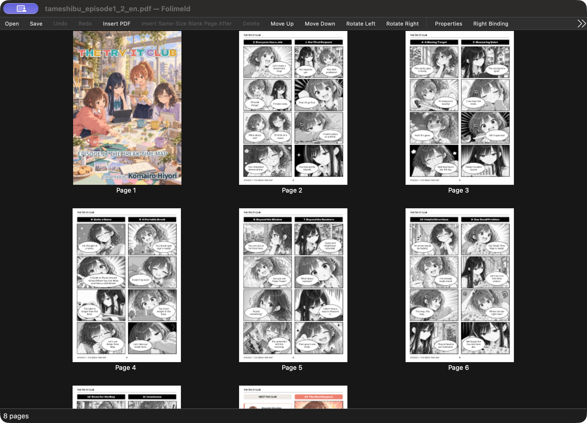
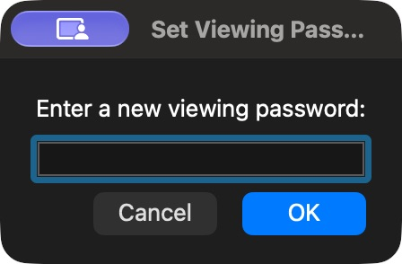

# Folimeld

[English](README.md) | [日本語](README_ja.md)

[Homepage](https://tyamada.github.io/Folimeld/)


Folimeld is a desktop application for visually rearranging, rotating, inserting, and deleting PDF pages. It is available for Windows, macOS, Ubuntu, and Debian, with preview releases for openSUSE, Fedora, AlmaLinux, FreeBSD, NetBSD, and OpenBSD. Files are processed locally without sending them to external services.



### Create a PDF from an image folder

Choose “File → Create PDF from image folder…” to list JPEG, PNG, BMP, TIFF, and WebP files directly in a folder. Sort by name, creation time, or modification time in ascending or descending order; the default is natural name order, ascending. Exclude unwanted images. Images are not decoded until you press Load. Each image becomes one page (each multipage TIFF frame becomes a page) in a new unsaved PDF for editing and saving. Choose image-sized pages or A4. Image orientation is applied and transparency is flattened onto white. Image-sized pages use image DPI, falling back to 300 DPI for missing or invalid values. Subfolders and animated WebP are excluded. Unavailable creation times sort last; equal timestamps use ascending name order. Conversion can be cancelled, and failures preserve the current document.


Choose File → Exit to close the app, with a save prompt for unsaved changes. On Windows, the image folder picker provides sidebar shortcuts to configured personal and work OneDrive folders. The initial folder picker displays all file types while accepting folders only.

## Features

- Multi-step Undo and Redo from the Edit menu or toolbar for page operations, properties, and viewing password changes. History remains available after saving and resets when another PDF is opened. PDF data in Undo and Redo history is kept in memory up to a combined 128 MiB; overflow is stored in local temporary files up to a combined 1 GiB. Older history is removed when both limits are exceeded or spilling fails; a single entry larger than the disk limit is not retained. Temporary history is released when the document is closed. Temporary data used during editing and saving, and thumbnails, are outside these limits, and whole-document processing can temporarily increase memory usage.
- Saving shows a progress dialog and compresses and writes the PDF in a separate process. Editing and cancellation are unavailable during saving. Preparing the document for the worker and switching documents after saving remain synchronous.
- Spilled history, temporary save-process input, and intermediate image-conversion PDFs are encrypted, with keys kept out of files and settings. User-selected output PDFs use the selected password settings.
- Rearrange PDF pages using thumbnail previews
- Select, move, rotate, or delete multiple pages at once
- Insert another PDF or a blank page of the same size
- Edit the PDF version, page layout, and binding direction
- Set or remove a password required to open a PDF
- Available in Japanese, English, German, Spanish, French, Korean, Portuguese, and Chinese
- Available for Windows 11, macOS, Ubuntu, and Debian, with previews for openSUSE, Fedora, AlmaLinux, FreeBSD, NetBSD, and OpenBSD (see the table below for OS versions and CPUs)

Each BSD preview has its own target OS version, CPU, and verification record. See the OS sections below for the tested scope and installation instructions.

## Downloads

**Folimeld 1.0.1.0 for Windows 11 (x64)** is available for free on the Microsoft Store in Japan and the United States. [Microsoft Store (Japan)](https://apps.microsoft.com/detail/9P5X2JFZRJC3?hl=ja-JP&gl=JP) · [Microsoft Store (United States)](https://apps.microsoft.com/detail/9P5X2JFZRJC3?hl=en-US&gl=US)

Folimeld 0.3.4 for Ubuntu/Debian is available on [GitHub Releases](https://github.com/tyamada/Folimeld/releases/tag/linux-v0.3.4). Separate 0.3.5 previews are available for [openSUSE Leap 16.1 amd64](https://github.com/tyamada/Folimeld/releases/tag/opensuse-leap161-amd64-v0.3.5), [Fedora 44 amd64](https://github.com/tyamada/Folimeld/releases/tag/fedora44-amd64-v0.3.5), [Fedora 45 amd64](https://github.com/tyamada/Folimeld/releases/tag/fedora45-amd64-v0.3.5) and [AlmaLinux 9 amd64](https://github.com/tyamada/Folimeld/releases/tag/almalinux9-amd64-v0.3.5).

Linux 0.3.3 packages, matching source ZIPs, checksums and build records are available in the [Linux GitHub Release](https://github.com/tyamada/Folimeld/releases/tag/linux-v0.3.3). FreeBSD, NetBSD, and OpenBSD previews are distributed through their dedicated Releases below. See the [Linux migration plan and implementation record](documentation/linux-release-migration.md). Existing repository download URLs remain available for compatibility.

| OS | CPU | Distribution and version | Release |
| --- | --- | --- | --- |
| Windows 11 | x64 | Microsoft Store / 1.0.1.0 | [Matching source](https://github.com/tyamada/Folimeld/releases/tag/windows-store-v1.0.1.0) |
| macOS 15 or later | Apple Silicon (arm64) | Homebrew / 0.3.3 (source) | [Release](https://github.com/tyamada/Folimeld/releases/tag/macos-source-v0.3.3) |
| Ubuntu 24.04 | amd64 / arm64 | DEB / Snap / 0.3.4 | [Release](https://github.com/tyamada/Folimeld/releases/tag/linux-v0.3.4) |
| Debian 13 | amd64 / arm64 | DEB / 0.3.4 | [Release](https://github.com/tyamada/Folimeld/releases/tag/linux-v0.3.4) |
| openSUSE Leap 16.1 (verified on WSL2/WSLg) | amd64 | RPM / 0.3.5-1 (preview) | [Release](https://github.com/tyamada/Folimeld/releases/tag/opensuse-leap161-amd64-v0.3.5) |
| Fedora 44 (verified on WSL2/WSLg) | amd64 | RPM / 0.3.5-2 (preview) | [Release](https://github.com/tyamada/Folimeld/releases/tag/fedora44-amd64-v0.3.5) |
| Fedora 45 (verified on WSL2/WSLg) | amd64 | RPM / 0.3.5-2 (preview) | [Release](https://github.com/tyamada/Folimeld/releases/tag/fedora45-amd64-v0.3.5) |
| AlmaLinux 9.8 (verified on WSL2/WSLg) | amd64 | RPM / 0.3.5-5 (preview) | [Release](https://github.com/tyamada/Folimeld/releases/tag/almalinux9-amd64-v0.3.5) |
| FreeBSD 15.1 | amd64 | pkg / 0.3.3_1 (preview) | [Release](https://github.com/tyamada/Folimeld/releases/tag/freebsd-v0.3.3) |
| FreeBSD 15.1 | aarch64 | pkg / 0.3.3_1 (preview) | [Release](https://github.com/tyamada/Folimeld/releases/tag/freebsd-aarch64-v0.3.3_1) |
| NetBSD 11.1 | amd64 | tgz / 0.3.3 (preview) | [Release](https://github.com/tyamada/Folimeld/releases/tag/netbsd-v0.3.3) |
| NetBSD 11.1 | aarch64 | tgz / 0.3.3 (preview) | [Release](https://github.com/tyamada/Folimeld/releases/tag/netbsd-aarch64-v0.3.3) |
| OpenBSD 8.0 | amd64 | Signed tgz / 0.3.3 (preview) | [Release](https://github.com/tyamada/Folimeld/releases/tag/openbsd-v0.3.3) |
| OpenBSD 8.0 | arm64 | Signed tgz / 0.3.3 (preview) | [Release](https://github.com/tyamada/Folimeld/releases/tag/openbsd-aarch64-v0.3.3) |

Versions in the table are specific to each distribution channel. The Windows Store edition is available in Japan and the United States. Linux 0.3.3 downloads for Ubuntu 22.04 or later and older installation instructions remain below. BSD ARM64 packages use the name `aarch64` on FreeBSD and NetBSD, and `arm64` on OpenBSD.

> [!NOTE]
> Windows test binaries and locally built macOS apps and installers are kept locally. Public source archives are available from their respective Releases.

### Windows 11 installation and corresponding source

- **Install from the Microsoft Store** — Open the Japan or United States listing above, then select **Get** or **Install** in the Microsoft Store. Launch Folimeld from the Start menu when installation completes.
- **Get the source** — Use **Code → Download ZIP** or Git to get the Windows code and build scripts from the [public main branch](https://github.com/tyamada/Folimeld/tree/main).
- **Source for Store version 1.0.1.0 x64** — [Source ZIP](https://github.com/tyamada/Folimeld/releases/download/windows-store-v1.0.1.0/Folimeld-1.0.1.0-windows-x64-source.zip) · [SHA-256 checksums](https://github.com/tyamada/Folimeld/releases/download/windows-store-v1.0.1.0/SHA256SUMS.txt) · [Submission association record](https://github.com/tyamada/Folimeld/releases/download/windows-store-v1.0.1.0/source-association.json). Three documentation files were revised for publication. The application source and build files match the submitted build's source snapshot.

Windows 11 releases are distributed through the Microsoft Store. See the [development guide](DEVELOPMENT.md) for the Store MSIX workflow.

### Install on macOS with Homebrew

The Folimeld 0.3.3 Homebrew release supports **Apple Silicon (arm64) Macs running macOS 15 Sequoia or later**. With Homebrew installed, run these commands in Terminal.

```sh
brew install --build-from-source tyamada/tap/folimeld
folimeld
```

Homebrew sets up Python 3.14 and an isolated environment for the app's dependencies. The `folimeld` command opens the PDF editor.

The [Folimeld 0.3.3 GitHub Release for macOS](https://github.com/tyamada/Folimeld/releases/tag/macos-source-v0.3.3) includes the [source archive](https://github.com/tyamada/Folimeld/releases/download/macos-source-v0.3.3/folimeld-0.3.3-source.tar.gz) and [SHA-256 checksums](https://github.com/tyamada/Folimeld/releases/download/macos-source-v0.3.3/SHA256SUMS.txt).

### Direct downloads for Ubuntu / Debian

#### Folimeld 0.3.4

| Package | Supported distributions | Downloads |
| --- | --- | --- |
| DEB | Ubuntu 24.04 / Debian 13 | [amd64](https://github.com/tyamada/Folimeld/releases/download/linux-v0.3.4/folimeld_0.3.4_amd64.deb) / [ARM64](https://github.com/tyamada/Folimeld/releases/download/linux-v0.3.4/folimeld_0.3.4_arm64.deb) |
| Snap | Ubuntu 24.04 (requires snapd) | [amd64](https://github.com/tyamada/Folimeld/releases/download/linux-v0.3.4/folimeld_0.3.4_amd64.snap) / [ARM64](https://github.com/tyamada/Folimeld/releases/download/linux-v0.3.4/folimeld_0.3.4_arm64.snap) |

The [Linux 0.3.4 GitHub Release](https://github.com/tyamada/Folimeld/releases/tag/linux-v0.3.4) includes matching source archives and build records. Verify downloads against [SHA256SUMS.txt](https://github.com/tyamada/Folimeld/releases/download/linux-v0.3.4/SHA256SUMS.txt).

#### Folimeld 0.3.3

Version **0.3.3 / x86_64 (amd64)**:

- [Download the x86_64 deb package](https://github.com/tyamada/Folimeld/releases/download/linux-v0.3.3/folimeld_0.3.3_amd64.deb) (Ubuntu 22.04 or later / Debian 13)
- [Download the x86_64 Snap package](https://github.com/tyamada/Folimeld/releases/download/linux-v0.3.3/folimeld_0.3.3_amd64.snap) (requires snapd)
- [SHA-256 checksums](https://github.com/tyamada/Folimeld/releases/download/linux-v0.3.3/folimeld_0.3.3_SHA256SUMS.txt)
- [Build source snapshots and artifact records](https://github.com/tyamada/Folimeld/releases/tag/linux-v0.3.3)

Run the installation command for your chosen package from the download folder.

```bash
# deb package
sudo apt install ./folimeld_0.3.3_amd64.deb

# Snap package
sudo snap install --dangerous ./folimeld_0.3.3_amd64.snap
```

Version **0.3.3 / arm64 (AArch64)**:

- [Download the arm64 deb package](https://github.com/tyamada/Folimeld/releases/download/linux-v0.3.3/folimeld_0.3.3_arm64.deb) (Ubuntu 22.04 or later / Debian 13)
- [Download the arm64 Snap package](https://github.com/tyamada/Folimeld/releases/download/linux-v0.3.3/folimeld_0.3.3_arm64.snap) (requires snapd)
- [SHA-256 checksums](https://github.com/tyamada/Folimeld/releases/download/linux-v0.3.3/folimeld_0.3.3_SHA256SUMS.txt)
- [Build source snapshots and artifact records](https://github.com/tyamada/Folimeld/releases/tag/linux-v0.3.3)

```bash
# arm64 deb package
sudo apt install ./folimeld_0.3.3_arm64.deb

# arm64 Snap package
sudo snap install --dangerous ./folimeld_0.3.3_arm64.snap
```

Debian 13 uses the same deb package as Ubuntu. If a minimal installation displays `Fontconfig error: Cannot load default config file`, run `sudo apt install fontconfig-config`. PDF display, page movement, rotation, saving, and reopening have been verified on Debian 13.6 amd64 (WSL2 / WSLg, X11). See the [Debian verification record](documentation/debian-wsl-verification_ja.md) (in Japanese) for details. Installation of the deb package and startup with a PDF have also been verified on arm64 (WSL2).

### openSUSE Leap 16.1 amd64 preview

**Folimeld 0.3.5 (RPM revision1)**, published on November 13, 2026 (Japan time), is a preview verified in dedicated openSUSE Leap 16.1 WSL2/WSLg environments.

- [amd64 RPM](https://github.com/tyamada/Folimeld/releases/download/opensuse-leap161-amd64-v0.3.5/folimeld-0.3.5-1.lp161.x86_64.rpm)
- [SHA256SUMS.txt](https://github.com/tyamada/Folimeld/releases/download/opensuse-leap161-amd64-v0.3.5/SHA256SUMS.txt)
- [Matching source, third-party notices, dependency sources, and verification records](https://github.com/tyamada/Folimeld/releases/tag/opensuse-leap161-amd64-v0.3.5)

Download the RPM and SHA256SUMS.txt into the same directory, verify them, and install. The RPM is unsigned. Only the specified local RPM is permitted; standard repository signature checks remain enabled.

```sh
sha256sum --ignore-missing -c SHA256SUMS.txt
sudo zypper install --allow-unsigned-rpm --no-recommends ./folimeld-0.3.5-1.lp161.x86_64.rpm
folimeld
```

Verification covered PDF editing, Japanese filename saving and GIO reopening, encrypted PDFs, image PDFs, Japanese input, updates, removal/reinstallation, preservation of existing test PDFs/settings, and offscreen startup in a fresh minimal installroot. Conventional desktops, conventional file-manager interaction, ARM64, Tumbleweed, and migration from public Ubuntu/Debian 0.3.4 are outside this verified scope. The minimal-dependency test uses chroot and does not verify independent WSL boot or GUI/IME in the minimal environment. See the [Release](https://github.com/tyamada/Folimeld/releases/tag/opensuse-leap161-amd64-v0.3.5) and [KNOWN-LIMITATIONS.txt](https://github.com/tyamada/Folimeld/releases/download/opensuse-leap161-amd64-v0.3.5/KNOWN-LIMITATIONS.txt) for synthetic GUI input failures/retests and wheel-provenance limits.

### Fedora 44 amd64 preview

**Folimeld 0.3.5 (RPM revision2)**, published on November 13, 2026 (Japan time), is a preview verified on Fedora 44 WSL2/WSLg.

- [amd64 RPM](https://github.com/tyamada/Folimeld/releases/download/fedora44-amd64-v0.3.5/folimeld-0.3.5-2.fc44.x86_64.rpm)
- [SHA256SUMS.txt](https://github.com/tyamada/Folimeld/releases/download/fedora44-amd64-v0.3.5/SHA256SUMS.txt)
- [Matching source, third-party notices, dependency sources, and verification records](https://github.com/tyamada/Folimeld/releases/tag/fedora44-amd64-v0.3.5)

Download the RPM and SHA256SUMS.txt into the same folder, verify them, and install. The RPM is unsigned.

```sh
sha256sum --ignore-missing -c SHA256SUMS.txt
sudo dnf install ./folimeld-0.3.5-2.fc44.x86_64.rpm
folimeld
```

Verification covered PDF editing, saving under a Japanese filename and reopening, password-protected PDFs, PDF creation from images, Japanese input, GIO launch, updates, and removal/reinstallation. A fresh minimal-dependency installroot passed offscreen startup and consistency checks. Conventional desktops, other distributions, ARM64, and migration from public Ubuntu/Debian 0.3.4 packages remain untested. The minimal-dependency test does not verify independent WSL boot or Japanese GUI/IME operation. See the Release body and [KNOWN-LIMITATIONS.txt](https://github.com/tyamada/Folimeld/releases/download/fedora44-amd64-v0.3.5/KNOWN-LIMITATIONS.txt) for the tested scope and provenance limits. Existing downloads and the latest release remain unchanged.

### Fedora 45 amd64 preview

**Folimeld 0.3.5 (RPM revision2)**, published on November 13, 2026 (Japan time), is a preview verified on Fedora 45 WSL2/WSLg.

- [amd64 RPM](https://github.com/tyamada/Folimeld/releases/download/fedora45-amd64-v0.3.5/folimeld-0.3.5-2.fc45.x86_64.rpm)
- [SHA256SUMS.txt](https://github.com/tyamada/Folimeld/releases/download/fedora45-amd64-v0.3.5/SHA256SUMS.txt)
- [Matching source, third-party notices, dependency sources, and verification records](https://github.com/tyamada/Folimeld/releases/tag/fedora45-amd64-v0.3.5)

Download the RPM and SHA256SUMS.txt into the same folder, verify them, and install. The RPM is unsigned.

```sh
sha256sum --ignore-missing -c SHA256SUMS.txt
sudo dnf install ./folimeld-0.3.5-2.fc45.x86_64.rpm
folimeld
```

Verification covered PDF editing, saving under a Japanese filename and reopening, password-protected PDFs, PDF creation from images, Japanese input, GIO launch, updates, and removal/reinstallation. A fresh minimal-dependency installroot passed offscreen startup and consistency checks. Conventional desktops, Fedora 44, ARM64, and migration from public Ubuntu/Debian 0.3.4 packages remain untested. The minimal-dependency test does not verify independent WSL boot or Japanese GUI/IME operation. See the Release body and [KNOWN-LIMITATIONS.txt](https://github.com/tyamada/Folimeld/releases/download/fedora45-amd64-v0.3.5/KNOWN-LIMITATIONS.txt) for the tested scope and provenance limits. Existing downloads and the latest release remain unchanged.

### AlmaLinux 9 amd64 preview

**Folimeld 0.3.5 (RPM revision5)**, published on November 12, 2026, is a preview verified on AlmaLinux 9.8 under WSL2/WSLg.

- [amd64 RPM](https://github.com/tyamada/Folimeld/releases/download/almalinux9-amd64-v0.3.5/folimeld-0.3.5-5.alma9_8.x86_64.rpm)
- [SHA256SUMS.txt](https://github.com/tyamada/Folimeld/releases/download/almalinux9-amd64-v0.3.5/SHA256SUMS.txt)
- [Matching source, third-party notices, dependency-source materials, and verification records](https://github.com/tyamada/Folimeld/releases/tag/almalinux9-amd64-v0.3.5)

Download the RPM and SHA256SUMS.txt into the same folder, verify the files, and install. The RPM is unsigned.

```sh
sha256sum --ignore-missing -c SHA256SUMS.txt
sudo dnf install ./folimeld-0.3.5-5.alma9_8.x86_64.rpm
folimeld
```

PDF editing, Save As, reopening, Japanese input, upgrades between candidates, and removal/reinstallation were verified. Conventional desktops, ARM64, AlmaLinux 10, and migration from public Ubuntu/Debian 0.3.4 remain untested. See the release description and [KNOWN-LIMITATIONS.txt](https://github.com/tyamada/Folimeld/releases/download/almalinux9-amd64-v0.3.5/KNOWN-LIMITATIONS.txt) for the detailed scope and provenance limits. Existing Ubuntu/Debian 0.3.4 distributions remain available.

### FreeBSD source, package, and installation

**0.3.3 / package revision 1** for FreeBSD 15.1 / amd64 is available as a preview in the [GitHub Release](https://github.com/tyamada/Folimeld/releases/tag/freebsd-v0.3.3). This is not an official FreeBSD package. Installation, GUI launch, saving, removal, and reinstallation have been verified.

- [Download the amd64 pkg](https://github.com/tyamada/Folimeld/releases/download/freebsd-v0.3.3/folimeld-0.3.3_1.pkg)
- [Matching source ZIP for this pkg](https://github.com/tyamada/Folimeld/releases/download/freebsd-v0.3.3/Folimeld-source-9ceb5ec75dcd3ddb60bb66f0b6996da5e700cf4400bd89b31808f5250b19f23b.zip)
- [SHA-256 checksums](https://github.com/tyamada/Folimeld/releases/download/freebsd-v0.3.3/SHA256SUMS.txt)
- [Dependency sources, wheel, and build records](https://github.com/tyamada/Folimeld/releases/tag/freebsd-v0.3.3)

See the [installation and build instructions](documentation/freebsd-install.md) and [package verification record (Japanese)](documentation/freebsd-package-verification_ja.md). Use the matching source ZIP above when rebuilding this package.

On FreeBSD with a configured graphical desktop, run the following as root after obtaining the package. Python, Qt, and other dependencies are installed from the official repository.

```sh
pkg install python312 py312-pyside6 py312-pillow py312-cryptography py312-psutil noto-sans-jp
pkg add ./folimeld-0.3.3_1.pkg
```

Run `folimeld` or `folimeld /path/to/file.pdf` as a regular user. To uninstall, run `pkg delete folimeld` as root. PyMuPDF/MuPDF 1.28.2, which fixes the form-loading crash, is bundled in the application's private directory without replacing system PyMuPDF. This amd64 package was verified on FreeBSD 15.1 / amd64. See the [GUI verification](documentation/freebsd-gui-verification_ja.md) and [image import, save failure, and load tests](documentation/freebsd-extended-verification_ja.md) (Japanese).

**0.3.3 / package revision 1** for **FreeBSD 15.1 / aarch64** is available in the [ARM64 preview release](https://github.com/tyamada/Folimeld/releases/tag/freebsd-aarch64-v0.3.3_1).

- [aarch64 pkg](https://github.com/tyamada/Folimeld/releases/download/freebsd-aarch64-v0.3.3_1/folimeld-0.3.3_1.pkg)
- [aarch64 installation instructions](https://github.com/tyamada/Folimeld/releases/download/freebsd-aarch64-v0.3.3_1/INSTALL.txt)

The release also includes matching source and SHA-256 checksums. The package was tested on FreeBSD 15.1 / aarch64 in an Xorg desktop session under QEMU with HVF on a MacBook Air M5.

### NetBSD source, package, and installation

The NetBSD 11.1 / amd64 [package `folimeld-0.3.3.tgz`](https://github.com/tyamada/Folimeld/releases/download/netbsd-v0.3.3/folimeld-0.3.3.tgz) and [matching source, dependency sources, and build record](https://github.com/tyamada/Folimeld/releases/tag/netbsd-v0.3.3) are available as a preview release. Compare `sha256 -r folimeld-0.3.3.tgz` with the [SHA-256 list](https://github.com/tyamada/Folimeld/releases/download/netbsd-v0.3.3/SHA256SUMS.txt). PySide6/shiboken6 and PyMuPDF/MuPDF are bundled privately; Python, Qt, and other dependencies use official packages. See the [installation and source build instructions](documentation/netbsd-install.md).

After obtaining the package, run as root on NetBSD with an X11 desktop configured.

```sh
export PKG_PATH=https://cdn.netbsd.org/pub/pkgsrc/packages/NetBSD/x86_64/11.0_2026Q3/All
/usr/pkg/sbin/pkg_add ./folimeld-0.3.3.tgz
```

Run `/usr/pkg/bin/folimeld` or `/usr/pkg/bin/folimeld /path/to/file.pdf` as a regular user. Remove as root with `/usr/pkg/sbin/pkg_delete folimeld`. These commands target amd64. For aarch64, use the dedicated instructions below.

**0.3.3** for **NetBSD 11.1 / aarch64** is available in the [ARM64 preview release](https://github.com/tyamada/Folimeld/releases/tag/netbsd-aarch64-v0.3.3).

- [aarch64 tgz](https://github.com/tyamada/Folimeld/releases/download/netbsd-aarch64-v0.3.3/folimeld-0.3.3.tgz)
- [aarch64 installation instructions](https://github.com/tyamada/Folimeld/releases/download/netbsd-aarch64-v0.3.3/INSTALL.txt)

### OpenBSD source, packages, and installation

The [application package](https://github.com/tyamada/Folimeld/releases/download/openbsd-v0.3.3/folimeld-0.3.3.tgz), [private MuPDF dependency](https://github.com/tyamada/Folimeld/releases/download/openbsd-v0.3.3/folimeld-mupdf-1.28.2.tgz), and [matching source, dependency sources, and build records](https://github.com/tyamada/Folimeld/releases/tag/openbsd-v0.3.3) for OpenBSD 8.0 / amd64 are available as a preview. These are not official OpenBSD packages.

The [matching application source ZIP](https://github.com/tyamada/Folimeld/releases/download/openbsd-v0.3.3/Folimeld-source-f67bd8d6672b4e7377126bfc24e1c7d7661004d454693a3cd1fe622b02e75be9.zip) and [SHA-256 list](https://github.com/tyamada/Folimeld/releases/download/openbsd-v0.3.3/SHA256SUMS.txt) are also available.

Download both packages, `folimeld-80-pkg.pub`, `SHA256SUMS.txt`, and `SHA256SUMS.txt.sig` from the Release. Follow the [public-key verification, installation, and source build instructions](documentation/openbsd-install.md), then verify the signature and compare package SHA-256 hashes as a regular user.

```sh
signify -V -p folimeld-80-pkg.pub -m SHA256SUMS.txt -x SHA256SUMS.txt.sig
sha256 -r folimeld-0.3.3.tgz folimeld-mupdf-1.28.2.tgz
```

On a system configured with an X11 desktop and official OpenBSD 8.0 package sources, run as root. Official dependencies including Python and PySide6/Qt are also installed.

```sh
install -m 644 folimeld-80-pkg.pub /etc/signify/folimeld-80-pkg.pub
pkg_add ./folimeld-mupdf-1.28.2.tgz ./folimeld-0.3.3.tgz
```

Run `folimeld` or `folimeld /path/to/file.pdf` as a regular user. Remove as root with `pkg_delete folimeld`, then `pkg_delete folimeld-mupdf` if the private dependency is no longer needed. System PyMuPDF is not replaced. The amd64 packages above were verified in a VM with 1 vCPU and 16 GiB of RAM.

**0.3.3** for **OpenBSD 8.0 / arm64** is available in the [ARM64 preview release](https://github.com/tyamada/Folimeld/releases/tag/openbsd-aarch64-v0.3.3). The application and private MuPDF packages use the same signing key as the amd64 release.

- [arm64 application package](https://github.com/tyamada/Folimeld/releases/download/openbsd-aarch64-v0.3.3/folimeld-0.3.3.tgz)
- [arm64 private MuPDF package](https://github.com/tyamada/Folimeld/releases/download/openbsd-aarch64-v0.3.3/folimeld-mupdf-1.28.2.tgz)
- [arm64 signature verification and installation](https://github.com/tyamada/Folimeld/releases/download/openbsd-aarch64-v0.3.3/INSTALL.txt)

## Basic usage

Open **Help → User guide** or press F1 to view basic operations, settings, and keyboard shortcuts. You can keep the guide open while working on a PDF.

1. Launch Folimeld and select a PDF using **File → Open**.
2. Click a page to select it. Use Ctrl or Shift to select multiple pages.
3. Edit pages using the toolbar, menus, or drag and drop.
4. Export the PDF using **Save** or **Save As**.

Opening a password-protected PDF displays a prompt for the password required to open it.



### Document settings

The **Details** tab in **Document Properties** lets you change the PDF version and page layout. Selecting `TwoPageLeft` or `TwoPageRight` raises the PDF version to 1.5 if necessary.

### Saved preferences

Under **Settings → Image Size**, choose a thumbnail size of 144, 288, or 432 px for the longer edge (default: 288 px). Changes take effect immediately.

The display language, image size, and last opened folder are saved on your device. PDFs are processed locally.

Microsoft Store version 1.0.1.0 does not offer supporter purchases.

In the Linux edition, **Help → Support development…** displays information about [GitHub Sponsors](https://github.com/sponsors/tyamada). The button in the dialog opens the support page in your browser. Support is optional, and all features remain available whether or not you contribute.

## TODO

- Verify the Windows 11 x64 upgrade from Store version 1.0.1.0, including preference retention and PDF operations.
- Verify dependencies and behavior on Windows 11 ARM64 hardware before deciding whether to distribute a native build.

## Known issues and limitations

- Microsoft Store version 1.0.1.0 targets Windows 11 x64. A native ARM64 Store package is pending.
- The main window of the Store-delivered build was confirmed to use Per-Monitor V2. Visual layout and operation at 150% and 200% scaling remain untested.
- Earlier local WACK runs on development builds reported a DPI warning (TEST92) and an optional test failure (TEST88). The cause of the earlier DPI warning and the individual Store certification outcomes for TEST92, TEST88 and `runFullTrust` remain unconfirmed. Store version 1.0.1.0 passed certification overall. [Acceptance record](documentation/windows-store-acceptance.md)

## Development and contributions

See [DEVELOPMENT.md](DEVELOPMENT.md) for instructions on running from source, testing, and building packages for each operating system. Report bugs and suggest improvements through [Issues](https://github.com/tyamada/Folimeld/issues).

Release history is available in [CHANGELOG.md](CHANGELOG.md).

## License

Folimeld is released under the [GNU Affero General Public License v3.0](LICENSE).

Third-party libraries, including PySide6 and PyMuPDF, are covered by their respective licenses.

The full license texts and third-party notices are available under **Help → Licenses**.
See [Licensing and distribution](documentation/license-distribution_ja.md) (in Japanese) for distribution requirements.
