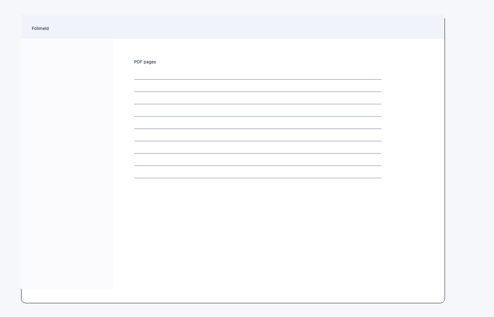
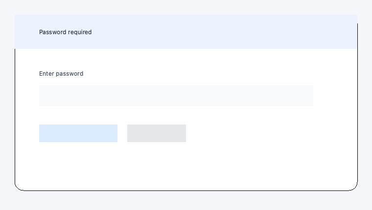

# Folimeld

[English](README.md) | [日本語](README_ja.md)


Folimeld は、PDF のページを見ながら並べ替え、回転、挿入、削除できるデスクトップアプリです。Windows、macOS、Ubuntu、Debian、FreeBSD 15.1（amd64・ARM64）に対応し、編集するファイルを外部サービスへ送信せず、ローカル環境で処理します。



### 画像フォルダからPDFを作成

「ファイル → 画像フォルダからPDFを作成…」でフォルダ直下のJPEG・PNG・BMP・TIFF・WebPを一覧表示し、名前・作成日時・更新日時の昇順／降順を選択できます。初期値は名前の自然順・昇順です。不要な画像は除外できます。「読み込み」を押すまで画像のデコードは行いません。1画像を1ページ（複数ページTIFFは各フレームを1ページ）に変換し、新規の未保存PDFとして編集・保存できます。ページサイズは画像に合わせるかA4を選択できます。画像の向きを反映し、透明部分は白背景にします。画像サイズはDPI（不明・異常時は300 DPI）から決定します。サブフォルダとアニメーションWebPは対象外です。作成日時を取得できない画像は末尾に配置し、同一日時は名前の昇順です。変換はキャンセルでき、失敗時は現在の文書を保持します。


「ファイル → 終了」でアプリを終了できます。未保存の変更があれば保存を確認します。Windows版の画像フォルダ選択画面では、設定済みの個人用・職場用OneDriveフォルダを左側のショートカットから選択できます。最初のフォルダ選択画面でもすべての種類のファイル名を表示し、選択対象はフォルダに限定します。

## 特長

- 編集メニューまたはツールバーから複数回のUndo（元に戻す）・Redo（やり直す）。ページ操作、プロパティ、閲覧パスワードの変更に対応。保存後も履歴を保持し、別のPDFを開くとリセットします。Undo・Redo履歴のPDFデータは合計128 MiBまでメモリに保持し、超過分は合計1 GiBまでローカルの一時ファイルへ退避します。両方の上限を超えた場合や退避に失敗した場合は古い履歴から削除し、1件がディスク上限を超える場合は保持しません。一時履歴は文書を閉じる際に解放します。編集・保存中の一時データやサムネイルはこの上限に含まれず、文書全体の一時的なメモリ使用量は増える場合があります。
- 保存中は進捗画面を表示し、PDFの圧縮・書き出しを別プロセスで処理します。保存中の編集とキャンセルはできません。別プロセスへ渡す文書の準備と保存完了時の文書切替は同期処理です。
- 履歴の退避、保存処理の一時入力、画像変換中の一時PDFは暗号化し、鍵はファイルや設定へ保存しません。利用者が指定する保存先PDFには、選択したパスワード設定を適用します。
- サムネイルを見ながらPDFページを並べ替え
- 複数ページをまとめて選択・移動・回転・削除
- 別のPDFや、同じサイズの空白ページを挿入
- PDFバージョン、ページレイアウト、綴じ方向を編集
- 閲覧パスワードの設定と解除
- 日本語、英語、ドイツ語、スペイン語、フランス語、韓国語、ポルトガル語、中国語に対応
- Windows 11（Intel/AMD x64）、macOS、Ubuntu、Debian、FreeBSD 15.1（amd64・ARM64）で利用可能

OpenBSD 8.0 / amd64向けにも署名付きパッケージと対応ソースを試験配布しています。検証は1 vCPU・16 GiBのVirtualBox VMで実施しました。導入方法は下記のOpenBSD節、確認範囲は[検証記録](documentation/openbsd-package-verification_ja.md)を参照してください。

## ダウンロード

Windows版の **Folimeld 1.0.1.0（Windows 11 x64）** は、Microsoft Storeで日本と米国に公開しています。無料で入手できます。 [日本のMicrosoft Store](https://apps.microsoft.com/detail/9P5X2JFZRJC3?hl=ja-JP&gl=JP) · [米国のMicrosoft Store](https://apps.microsoft.com/detail/9P5X2JFZRJC3?hl=en-US&gl=US)

Linux版Folimeld 0.3.4を[GitHub Releases](https://github.com/tyamada/Folimeld/releases/tag/linux-v0.3.4)で公開しています。

Linux 0.3.3のパッケージ、対応ソースZIP、チェックサム、ビルド記録は[Linux版GitHub Release](https://github.com/tyamada/Folimeld/releases/tag/linux-v0.3.3)から取得できます。FreeBSD版・NetBSD版・OpenBSD版は下記の専用Releaseで試験配布しています。[Linux版の移行計画と実施記録](documentation/linux-release-migration_ja.md)を参照してください。互換性のため従来のリポジトリ内のダウンロードURLも維持しています。

| OS | 配布形式 |
| --- | --- |
| Windows 11（Intel/AMD x64） | Microsoft Store（MSIX、1.0.1.0、日本・米国） |
| macOS | `.app`（バイナリ非公開） |
| Ubuntu | `.deb` / `.snap` / 単体実行ファイル（対応バージョンは各リリースを参照） |
| Debian 13 | `.deb`（amd64 / arm64、WSL2で基本動作確認済み） |
| FreeBSD 15.1 / amd64 | ネイティブ `.pkg` と対応ソース（試験配布） |
| FreeBSD 15.1 / aarch64 | ネイティブ `.pkg` と対応ソース（試験配布） |
| NetBSD 11.1 / amd64 | ネイティブ `.tgz` と対応ソース（試験配布） |
| NetBSD 11.1 / aarch64 | ネイティブ `.tgz` と対応ソース（試験配布） |
| OpenBSD 8.0 / amd64 | 署名付きネイティブ `.tgz` と対応ソース（試験配布） |
| OpenBSD 8.0 / arm64 | 署名付きネイティブ `.tgz` と対応ソース（試験配布） |

> [!NOTE]
> Windows・macOSの検証用成果物は、公開リポジトリやGitHub Releasesへ追加しません。

### Windows 11のインストールとソースビルド

- **Microsoft Storeからインストール** — 上の日本または米国の掲載リンクを開き、Microsoft Storeで「入手」または「インストール」を選びます。完了後、スタートメニューからFolimeldを起動します。
- **ソースを取得** — [公開リポジトリのmain](https://github.com/tyamada/Folimeld/tree/main)の「Code → Download ZIP」またはGitから、Windows用コードとビルドスクリプトを取得できます。
- **Store版1.0.1.0 x64の対応ソース** — [ソースZIP](https://github.com/tyamada/Folimeld/releases/download/windows-store-v1.0.1.0/Folimeld-1.0.1.0-windows-x64-source.zip) · [SHA-256一覧](https://github.com/tyamada/Folimeld/releases/download/windows-store-v1.0.1.0/SHA256SUMS.txt) · [提出物との対応記録](https://github.com/tyamada/Folimeld/releases/download/windows-store-v1.0.1.0/source-association.json)。公開用ZIPでは文書3件を公開向けに整理し、アプリコードとビルド用ファイルは提出時のソースと同一です。

Windows 11 x64で、Gitとx64版Python 3.14を用意します。取得したソースのルートでPowerShellを開き、次を実行します。

```powershell
py -3.14 -m venv .venv
.\.venv\Scripts\python.exe -m pip install -r requirements.txt -c constraints-release.txt pyinstaller
.\build_exe.bat
```

生成された `dist\Folimeld.exe` を直接起動できます。ローカル試験用のMSIXを作るには、Windows SDKのMakeAppxを導入し、同じソースのルートで次を実行します。

```powershell
powershell -NoProfile -ExecutionPolicy Bypass -File .\build_msix.ps1 -Architecture x64
```

生成される `dist\Folimeld_<版>_x64.msix` は未署名です。試験機への導入には、Windows SDKのSignToolを使った[開発用MSIXの署名・導入・後始末手順](documentation/windows-store-test-bundle_ja.md)に従ってください。Store向けのビルドには別途、[StoreのパッケージID・発行元を使う手順](documentation/windows-store-release-plan_ja.md)があります。

### Ubuntu / Debian版を直接ダウンロード

#### Folimeld 0.3.4

| パッケージ | 対応ディストリビューション | ダウンロード |
| --- | --- | --- |
| DEB | Ubuntu 24.04 / Debian 13 | [amd64](https://github.com/tyamada/Folimeld/releases/download/linux-v0.3.4/folimeld_0.3.4_amd64.deb) / [ARM64](https://github.com/tyamada/Folimeld/releases/download/linux-v0.3.4/folimeld_0.3.4_arm64.deb) |
| Snap | Ubuntu 24.04（snapdが必要） | [amd64](https://github.com/tyamada/Folimeld/releases/download/linux-v0.3.4/folimeld_0.3.4_amd64.snap) / [ARM64](https://github.com/tyamada/Folimeld/releases/download/linux-v0.3.4/folimeld_0.3.4_arm64.snap) |

[Linux版0.3.4のGitHub Release](https://github.com/tyamada/Folimeld/releases/tag/linux-v0.3.4)に対応ソースとビルド記録を掲載しています。ダウンロードしたファイルは[SHA256SUMS.txt](https://github.com/tyamada/Folimeld/releases/download/linux-v0.3.4/SHA256SUMS.txt)と照合できます。

#### Folimeld 0.3.3

バージョン **0.3.3 / x86_64（amd64）**：

- [x86_64版debパッケージをダウンロード](https://github.com/tyamada/Folimeld/releases/download/linux-v0.3.3/folimeld_0.3.3_amd64.deb)（Ubuntu 22.04以降 / Debian 13）
- [x86_64版Snapパッケージをダウンロード](https://github.com/tyamada/Folimeld/releases/download/linux-v0.3.3/folimeld_0.3.3_amd64.snap)（snapdが必要）
- [SHA-256チェックサム](https://github.com/tyamada/Folimeld/releases/download/linux-v0.3.3/folimeld_0.3.3_SHA256SUMS.txt)
- [ビルド時のソースと対応記録](https://github.com/tyamada/Folimeld/releases/tag/linux-v0.3.3)

ダウンロード先のフォルダーで、使用するパッケージのインストールコマンドを実行してください。

```bash
# deb版
sudo apt install ./folimeld_0.3.3_amd64.deb

# Snap版
sudo snap install --dangerous ./folimeld_0.3.3_amd64.snap
```

バージョン **0.3.3 / arm64（AArch64）**：

- [arm64版debパッケージをダウンロード](https://github.com/tyamada/Folimeld/releases/download/linux-v0.3.3/folimeld_0.3.3_arm64.deb)（Ubuntu 22.04以降 / Debian 13）
- [arm64版Snapパッケージをダウンロード](https://github.com/tyamada/Folimeld/releases/download/linux-v0.3.3/folimeld_0.3.3_arm64.snap)（snapdが必要）
- [SHA-256チェックサム](https://github.com/tyamada/Folimeld/releases/download/linux-v0.3.3/folimeld_0.3.3_SHA256SUMS.txt)
- [ビルド時のソースと対応記録](https://github.com/tyamada/Folimeld/releases/tag/linux-v0.3.3)

```bash
# arm64 deb版
sudo apt install ./folimeld_0.3.3_arm64.deb

# arm64 Snap版
sudo snap install --dangerous ./folimeld_0.3.3_arm64.snap
```

Debian 13ではUbuntu版と同じdebパッケージを使用します。最小構成の環境で `Fontconfig error: Cannot load default config file` が表示される場合は、`sudo apt install fontconfig-config` を実行してください。Debian 13.6のamd64環境（WSL2 / WSLg、X11）でPDFの表示・ページ移動・回転・保存・再読込を確認しています。詳しくは[Debianでの検証記録](documentation/debian-wsl-verification_ja.md)を参照してください。arm64環境（WSL2）でもdebのインストールとPDFを指定した起動を確認済みです。

### FreeBSD版のソース・パッケージ・インストール

FreeBSD 15.1 / amd64向けの **0.3.3 / パッケージ改訂1** を[GitHub Release](https://github.com/tyamada/Folimeld/releases/tag/freebsd-v0.3.3)で試験配布しています。FreeBSD公式パッケージではありません。導入・GUI起動・保存・削除・再導入を確認済みです。

- [amd64版pkgをダウンロード](https://github.com/tyamada/Folimeld/releases/download/freebsd-v0.3.3/folimeld-0.3.3_1.pkg)
- [このpkgに対応するソースZIP](https://github.com/tyamada/Folimeld/releases/download/freebsd-v0.3.3/Folimeld-source-9ceb5ec75dcd3ddb60bb66f0b6996da5e700cf4400bd89b31808f5250b19f23b.zip)
- [SHA-256チェックサム](https://github.com/tyamada/Folimeld/releases/download/freebsd-v0.3.3/SHA256SUMS.txt)
- [依存ソース・wheel・ビルド記録](https://github.com/tyamada/Folimeld/releases/tag/freebsd-v0.3.3)

[インストール・ビルド手順](documentation/freebsd-install_ja.md)と[パッケージ検証記録](documentation/freebsd-package-verification_ja.md)を参照してください。ソースから再構築する場合は、上記の対応ソースZIPを使用してください。

GUIデスクトップが構成されたFreeBSDで、パッケージ入手後は以下をrootで実行します。Python・Qtなどの依存パッケージは公式リポジトリから導入します。

```sh
pkg install python312 py312-pyside6 py312-pillow py312-cryptography py312-psutil noto-sans-jp
pkg add ./folimeld-0.3.3_1.pkg
```

一般ユーザーで `folimeld` または `folimeld /path/to/file.pdf` を実行します。削除はrootで `pkg delete folimeld`。フォーム読み込みの不具合を修正したPyMuPDF/MuPDF 1.28.2をアプリ専用領域に同梱し、システムのPyMuPDFは置き換えません。このamd64パッケージはFreeBSD 15.1 / amd64で検証しました。[GUI検証](documentation/freebsd-gui-verification_ja.md)と[画像取り込み・保存失敗・負荷試験](documentation/freebsd-extended-verification_ja.md)の記録も参照してください。

**FreeBSD 15.1 / aarch64** 向けの **0.3.3 / パッケージ改訂1** は、[ARM64試験配布](https://github.com/tyamada/Folimeld/releases/tag/freebsd-aarch64-v0.3.3_1)から取得できます。

- [aarch64版pkg](https://github.com/tyamada/Folimeld/releases/download/freebsd-aarch64-v0.3.3_1/folimeld-0.3.3_1.pkg)
- [aarch64版の導入手順](https://github.com/tyamada/Folimeld/releases/download/freebsd-aarch64-v0.3.3_1/INSTALL_ja.txt)

リリースには対応ソースとSHA-256チェックサムも掲載しています。MacBook Air M5上のQEMU（HVF）でFreeBSD 15.1 / aarch64を起動し、Xorgデスクトップでパッケージを検証しました。

### NetBSD版のソース・パッケージ・インストール

NetBSD 11.1 / amd64向けの[パッケージ `folimeld-0.3.3.tgz`](https://github.com/tyamada/Folimeld/releases/download/netbsd-v0.3.3/folimeld-0.3.3.tgz)と[対応ソース・依存ソース・ビルド記録](https://github.com/tyamada/Folimeld/releases/tag/netbsd-v0.3.3)を試験配布しています。[SHA-256一覧](https://github.com/tyamada/Folimeld/releases/download/netbsd-v0.3.3/SHA256SUMS.txt)と `sha256 -r folimeld-0.3.3.tgz` の結果を照合してください。PySide6/shiboken6とPyMuPDF/MuPDFをアプリ専用領域に同梱し、Python・Qtなどは公式パッケージに依存します。[インストール・ソースビルド手順](documentation/netbsd-install_ja.md)を参照してください。

パッケージ入手後、X11デスクトップを構成したNetBSDでrootとして実行します。

```sh
export PKG_PATH=https://cdn.netbsd.org/pub/pkgsrc/packages/NetBSD/x86_64/11.0_2026Q3/All
/usr/pkg/sbin/pkg_add ./folimeld-0.3.3.tgz
```

一般ユーザーで `/usr/pkg/bin/folimeld` または `/usr/pkg/bin/folimeld /path/to/file.pdf` を実行します。削除はrootで `/usr/pkg/sbin/pkg_delete folimeld`。他のNetBSD版・CPUは未検証です。

**NetBSD 11.1 / aarch64** 向けの **0.3.3** は、[ARM64試験配布](https://github.com/tyamada/Folimeld/releases/tag/netbsd-aarch64-v0.3.3)から取得できます。

- [aarch64版tgz](https://github.com/tyamada/Folimeld/releases/download/netbsd-aarch64-v0.3.3/folimeld-0.3.3.tgz)
- [aarch64版の導入手順](https://github.com/tyamada/Folimeld/releases/download/netbsd-aarch64-v0.3.3/INSTALL_ja.txt)

### OpenBSD版のソース・パッケージ・インストール

OpenBSD 8.0 / amd64向けの[本体パッケージ](https://github.com/tyamada/Folimeld/releases/download/openbsd-v0.3.3/folimeld-0.3.3.tgz)、[専用MuPDF依存](https://github.com/tyamada/Folimeld/releases/download/openbsd-v0.3.3/folimeld-mupdf-1.28.2.tgz)、[対応ソース・依存ソース・ビルド記録](https://github.com/tyamada/Folimeld/releases/tag/openbsd-v0.3.3)を試験配布しています。OpenBSD公式パッケージではありません。

[本体の対応ソースZIP](https://github.com/tyamada/Folimeld/releases/download/openbsd-v0.3.3/Folimeld-source-f67bd8d6672b4e7377126bfc24e1c7d7661004d454693a3cd1fe622b02e75be9.zip)と[SHA-256一覧](https://github.com/tyamada/Folimeld/releases/download/openbsd-v0.3.3/SHA256SUMS.txt)も取得できます。

Releaseから両パッケージ、`folimeld-80-pkg.pub`、`SHA256SUMS.txt`、`SHA256SUMS.txt.sig` を取得します。[公開鍵の照合・インストール・ソースビルド手順](documentation/openbsd-install_ja.md)に従い、一般ユーザーで署名とパッケージのSHA-256を確認してください。

```sh
signify -V -p folimeld-80-pkg.pub -m SHA256SUMS.txt -x SHA256SUMS.txt.sig
sha256 -r folimeld-0.3.3.tgz folimeld-mupdf-1.28.2.tgz
```

X11デスクトップとOpenBSD 8.0の公式パッケージ取得先を構成した環境で、rootとして実行します。Python・PySide6/Qtなどの公式依存も導入します。

```sh
install -m 644 folimeld-80-pkg.pub /etc/signify/folimeld-80-pkg.pub
pkg_add ./folimeld-mupdf-1.28.2.tgz ./folimeld-0.3.3.tgz
```

一般ユーザーで `folimeld` または `folimeld /path/to/file.pdf` を実行します。削除はrootで `pkg_delete folimeld`、専用依存も不要なら `pkg_delete folimeld-mupdf`。システムのPyMuPDFは置き換えません。上記のamd64版は1 vCPU・16 GiBのVMで検証しました。

**OpenBSD 8.0 / arm64** 向けの **0.3.3** は、[ARM64試験配布](https://github.com/tyamada/Folimeld/releases/tag/openbsd-aarch64-v0.3.3)から取得できます。本体と専用MuPDFはamd64版と同じ公開鍵で署名しています。

- [arm64版本体](https://github.com/tyamada/Folimeld/releases/download/openbsd-aarch64-v0.3.3/folimeld-0.3.3.tgz)
- [arm64版専用MuPDF](https://github.com/tyamada/Folimeld/releases/download/openbsd-aarch64-v0.3.3/folimeld-mupdf-1.28.2.tgz)
- [arm64版の署名照合と導入手順](https://github.com/tyamada/Folimeld/releases/download/openbsd-aarch64-v0.3.3/INSTALL_ja.txt)

## 基本的な使い方

「ヘルプ → 使い方」またはF1キーで、基本操作・設定・ショートカットを確認できます。ヘルプ画面を開いたままPDFを操作できます。

1. Folimeldを起動し、「ファイル」→「開く」からPDFを選択します。
2. ページをクリックして選択します。複数選択には Ctrl または Shift を使用します。
3. ツールバー、メニュー、またはドラッグ操作でページを編集します。
4. 「保存」または「名前を付けて保存」でPDFを書き出します。

パスワード付きPDFを開くと、閲覧パスワードの入力画面が表示されます。



### 文書設定

「文書のプロパティ」の「詳細」タブでは、PDFバージョンとページレイアウトを変更できます。`TwoPageLeft` または `TwoPageRight` を選択した場合、必要に応じてPDFバージョンが1.5へ引き上げられます。

### 設定の保存

「設定 > 画像サイズ」からサムネイルの長辺のサイズを144 / 288 / 432 pxから選択できます（初期値288 px）。変更はすぐに反映されます。

表示言語、画像サイズ、最後に開いたフォルダーは端末内に保存されます。PDFは端末内で処理されます。

Microsoft Store版 1.0.1.0 では、応援購入を提供していません。

Linux版では「ヘルプ → 開発を応援する…」に [GitHub Sponsors](https://github.com/sponsors/tyamada) への案内を表示します。案内画面のボタンからブラウザーで支援ページを開けます。支援は任意であり、利用できる機能は支援の有無で変わりません。

## TODO

- Windows 11 x64で、Store版1.0.1.0からの更新と、設定・PDF操作の保持を検証する。
- Windows 11 ARM64ネイティブ版は、依存ライブラリと実機での動作を確認したうえで配布を判断する。

## 既知の問題点と制約

- Microsoft Storeで配信中の1.0.1.0はWindows 11 x64向けです。ARM64ネイティブのStore配信版は未提供です。
- Store配信版のメインウィンドウはPer-Monitor V2を確認済みです。150％・200％での表示と操作は未検証です。
- 旧開発ビルドのローカルWACKではDPI警告（TEST92）と任意検査のFAIL（TEST88）が出ました。旧DPI警告の原因と、Store認定でのTEST92・TEST88・`runFullTrust` の個別判定は未確認です。Store版1.0.1.0は提出全体として認定に合格しています。[受入記録](documentation/windows-store-acceptance_ja.md)

## 開発・コントリビューション

ソースからの実行、テスト、各OS向けパッケージの作成方法は [DEVELOPMENT_ja.md](DEVELOPMENT_ja.md) を参照してください。不具合報告や提案は [Issues](https://github.com/tyamada/Folimeld/issues) で受け付けています。

変更履歴は [CHANGELOG_ja.md](CHANGELOG_ja.md) にまとめています。

## ライセンス

Folimeld は [GNU Affero General Public License v3.0](LICENSE) で公開されています。

PySide6、PyMuPDFなどの第三者ライブラリには、それぞれのライセンスが適用されます。

ライセンス全文と第三者の告知は「ヘルプ → ライセンス」で閲覧できます。
配布時の確認事項は [ライセンスと配布](documentation/license-distribution_ja.md) を参照してください。
